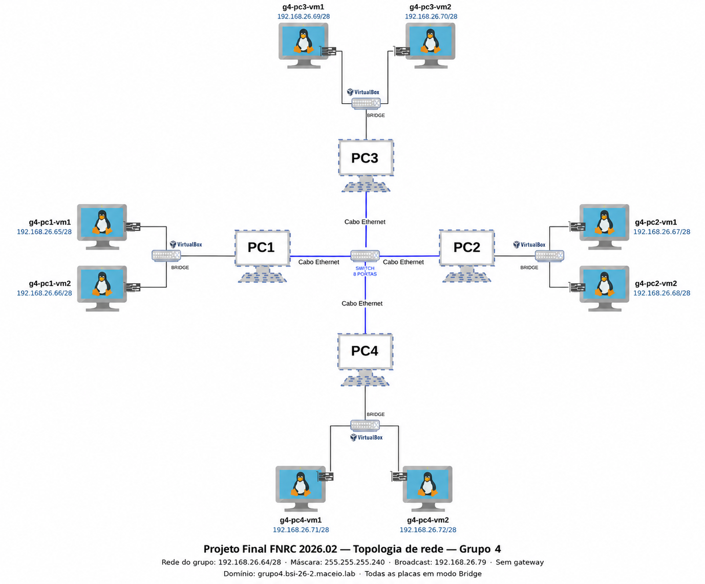
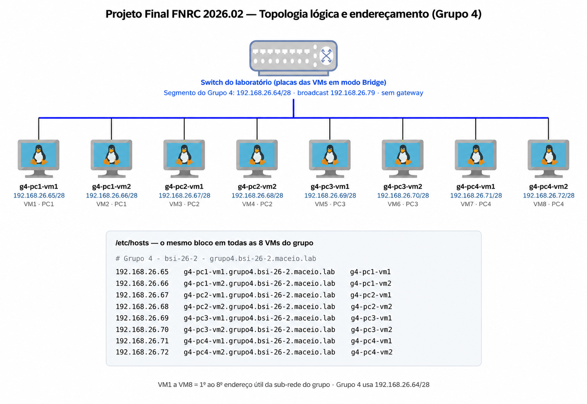

# Planejamento da Rede do Grupo 4

## 1. Identificação do grupo

- **Disciplina:** Fundamentos de Redes de Computadores
- **Turma:** BSI 2026.2 (`bsi-26-2`)
- **Grupo:** 4
- **Projeto:** Rede virtualizada com 8 máquinas virtuais Ubuntu Server

### 1.1 Integrantes e usuários planejados

| Integrante | Usuário da VM |
|---|---|
| Lukas Gomes | `lukas.gomes` |
| Allysson Matheus | `allysson.matheus` |
| Abel Lucas | `abel.lucas` |
| Vitor Henrique | `vitor.henrique` |

## 2. Endereçamento IPv4

| Parâmetro | Valor |
|---|---|
| Sub-rede | 192.168.26.64/28 |
| Máscara | 255.255.255.240 |
| Endereços utilizados | 192.168.26.65 a 192.168.26.72 |
| Endereços disponíveis | 192.168.26.73 a 192.168.26.78 |
| Broadcast | 192.168.26.79 |

## 3. Nomes e endereços das máquinas

| VM | PC | Hostname | Interface / modo | IP / máscara | FQDN |
|---|---|---|---|---|---|
| VM1 | PC1 | `g4-pc1-vm1` | `enp0s3` · Bridge | `192.168.26.65/28` | `g4-pc1-vm1.grupo4.bsi-26-2.maceio.lab` |
| VM2 | PC1 | `g4-pc1-vm2` | `enp0s3` · Bridge | `192.168.26.66/28` | `g4-pc1-vm2.grupo4.bsi-26-2.maceio.lab` |
| VM3 | PC2 | `g4-pc2-vm1` | `enp0s3` · Bridge | `192.168.26.67/28` | `g4-pc2-vm1.grupo4.bsi-26-2.maceio.lab` |
| VM4 | PC2 | `g4-pc2-vm2` | `enp0s3` · Bridge | `192.168.26.68/28` | `g4-pc2-vm2.grupo4.bsi-26-2.maceio.lab` |
| VM5 | PC3 | `g4-pc3-vm1` | `enp0s3` · Bridge | `192.168.26.69/28` | `g4-pc3-vm1.grupo4.bsi-26-2.maceio.lab` |
| VM6 | PC3 | `g4-pc3-vm2` | `enp0s3` · Bridge | `192.168.26.70/28` | `g4-pc3-vm2.grupo4.bsi-26-2.maceio.lab` |
| VM7 | PC4 | `g4-pc4-vm1` | `enp0s3` · Bridge | `192.168.26.71/28` | `g4-pc4-vm1.grupo4.bsi-26-2.maceio.lab` |
| VM8 | PC4 | `g4-pc4-vm2` | `enp0s3` · Bridge | `192.168.26.72/28` | `g4-pc4-vm2.grupo4.bsi-26-2.maceio.lab` |

## 4. Bloco planejado do `/etc/hosts`

```text
# Grupo 4 - bsi-26-2 - grupo4.bsi-26-2.maceio.lab

192.168.26.65    g4-pc1-vm1.grupo4.bsi-26-2.maceio.lab    g4-pc1-vm1
192.168.26.66    g4-pc1-vm2.grupo4.bsi-26-2.maceio.lab    g4-pc1-vm2
192.168.26.67    g4-pc2-vm1.grupo4.bsi-26-2.maceio.lab    g4-pc2-vm1
192.168.26.68    g4-pc2-vm2.grupo4.bsi-26-2.maceio.lab    g4-pc2-vm2
192.168.26.69    g4-pc3-vm1.grupo4.bsi-26-2.maceio.lab    g4-pc3-vm1
192.168.26.70    g4-pc3-vm2.grupo4.bsi-26-2.maceio.lab    g4-pc3-vm2
192.168.26.71    g4-pc4-vm1.grupo4.bsi-26-2.maceio.lab    g4-pc4-vm1
192.168.26.72    g4-pc4-vm2.grupo4.bsi-26-2.maceio.lab    g4-pc4-vm2
```

## 5. Planejamento da topologia da rede

### 5.1 Topologia física

| Computador físico | Máquinas virtuais |
|---|---|
| PC1 | `g4-pc1-vm1` e `g4-pc1-vm2` |
| PC2 | `g4-pc2-vm1` e `g4-pc2-vm2` |
| PC3 | `g4-pc3-vm1` e `g4-pc3-vm2` |
| PC4 | `g4-pc4-vm1` e `g4-pc4-vm2` |



### 5.2 Topologia lógica


