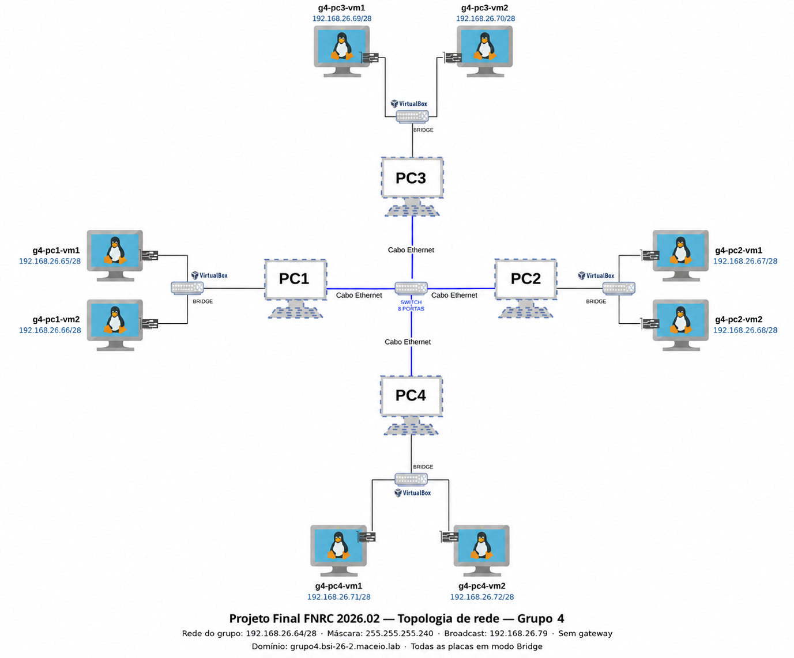
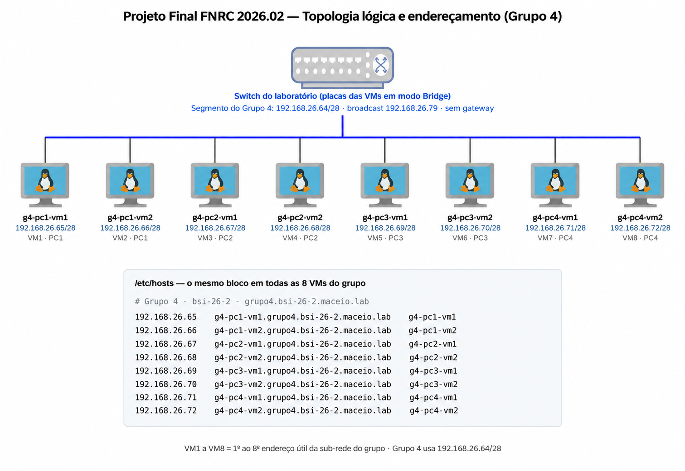

# Planejamento da Rede do Grupo 4

## 1. Identificação do grupo

- **Disciplina:** Fundamentos de Redes de Computadores
- **Turma:** BSI 2026.2 (`bsi-26-2`)
- **Grupo:** 4
- **Projeto:** Rede virtualizada com 8 máquinas virtuais Ubuntu Server

### 1.1 Integrantes e usuários planejados

Inicialmente, organizamos os integrantes do grupo e definimos os nomes de usuário que serão utilizados nas máquinas virtuais.
Para a padronização, utilizamos o formato nome.sobrenome, com letras minúsculas, sem espaços ou acentos.

| Integrante | Usuário da VM |
|---|---|
| Lukas Gomes | `lukas.gomes` |
| Allysson Matheus | `allysson.matheus` |
| Abel Lucas | `abel.lucas` |
| Vitor Henrique | `vitor.henrique` |

Esses usuários serão criados nas oito máquinas virtuais durante a implementação, juntamente com o usuário administrador.

## 2. Endereçamento IPv4

Para organizar o endereçamento da rede, identificamos a sub-rede correspondente ao Grupo 4.

A turma utiliza a rede 192.168.26.0/24, dividida em sub-redes /28, sendo uma destinada a cada grupo.

O endereço de cada sub-rede é determinado pela expressão:

192.168.26.(16 × X)/28

Substituindo X pelo número do nosso grupo:

16 × 4 = 64

Assim, identificamos a sub-rede 192.168.26.64/28.

Em seguida, organizamos os endereços disponíveis, reservando os oito primeiros endereços úteis para as máquinas virtuais.

| Parâmetro | Valor |
|---|---|
| Sub-rede | 192.168.26.64/28 |
| Máscara | 255.255.255.240 |
| Endereços utilizados | 192.168.26.65 a 192.168.26.72 |
| Endereços disponíveis | 192.168.26.73 a 192.168.26.78 |
| Broadcast | 192.168.26.79 |
| Gateway | Não utilizado |

Cada máquina virtual receberá um endereço IP exclusivo, evitando conflitos de endereçamento e permitindo a comunicação entre elas.

## 3. Nomes e endereços das máquinas

Após identificar a sub-rede, distribuímos os endereços IP entre as oito máquinas virtuais, considerando dois equipamentos virtuais para cada computador físico.

Para identificar as máquinas, utilizamos o padrão de hostname g4-pcY-vmZ, em que:

* g4 representa o Grupo 4;

* pcY identifica o computador físico;

* vmZ identifica a máquina virtual.

Também definimos o domínio grupo4.bsi-26-2.maceio.lab, utilizado na composição do FQDN de cada máquina.

Com essas informações, organizamos a tabela de endereçamento e identificação das VMs.

| VM | PC | Hostname | Interface / modo | IP / máscara | FQDN |
|---|---|---|---|---|---|
| VM1 | PC1 | `g4-pc1-vm1` | `enp0s3` · Bridge | `192.168.26.65/28` | `g4-pc1-vm1.grupo4.bsi-26-2.maceio.lab` |
| VM2 | PC1 | `g4-pc1-vm2` | `enp0s3` · Bridge | `192.168.26.66/28` | `g4-pc1-vm2.grupo4.bsi-26-2.maceio.lab` |
| VM3 | PC2 | `g4-pc2-vm1` | `enp0s3` · Bridge | `192.168.26.67/28` | `g4-pc2-vm1.grupo4.bsi-26-2.maceio.lab` |
| VM4 | PC2 | `g4-pc2-vm2` | `enp0s3` · Bridge | `192.168.26.68/28` | `g4-pc2-vm2.grupo4.bsi-26-2.maceio.lab` |
| VM5 | PC3 | `g4-pc3-vm1` | `enp0s3` · Bridge | `192.168.26.69/28` | `g4-pc3-vm1.grupo4.bsi-26-2.maceio.lab` |
| VM6 | PC3 | `g4-pc3-vm2` | `enp0s3` · Bridge | `192.168.26.70/28` | `g4-pc3-vm2.grupo4.bsi-26-2.maceio.lab` |
| VM7 | PC4 | `g4-pc4-vm1` | `enp0s3` · Bridge | `192.168.26.71/28` | `g4-pc4-vm1.grupo4.bsi-26-2.maceio.lab` |
| VM8 | PC4 | `g4-pc4-vm2` | `enp0s3` · Bridge | `192.168.26.72/28` | `g4-pc4-vm2.grupo4.bsi-26-2.maceio.lab` |

Para a configuração da rede, planejamos utilizar a interface enp0s3 em modo Placa em Ponte (Bridge), permitindo que as máquinas virtuais se comuniquem pela rede física do laboratório.

## 4. Bloco planejado do `/etc/hosts`

Com os endereços IP e os nomes definidos, organizamos o conteúdo que será utilizado no arquivo /etc/hosts das máquinas virtuais.

Para cada VM, associamos o endereço IP ao FQDN e ao hostname curto correspondente.

O bloco foi organizado da seguinte forma:

```text
# Grupo 4 - bsi-26-2 - grupo4.bsi-26-2.maceio.lab

192.168.26.65    g4-pc1-vm1.grupo4.bsi-26-2.maceio.lab    g4-pc1-vm1
192.168.26.66    g4-pc1-vm2.grupo4.bsi-26-2.maceio.lab    g4-pc1-vm2
192.168.26.67    g4-pc2-vm1.grupo4.bsi-26-2.maceio.lab    g4-pc2-vm1
192.168.26.68    g4-pc2-vm2.grupo4.bsi-26-2.maceio.lab    g4-pc2-vm2
192.168.26.69    g4-pc3-vm1.grupo4.bsi-26-2.maceio.lab    g4-pc3-vm1
192.168.26.70    g4-pc3-vm2.grupo4.bsi-26-2.maceio.lab    g4-pc3-vm2
192.168.26.71    g4-pc4-vm1.grupo4.bsi-26-2.maceio.lab    g4-pc4-vm1
192.168.26.72    g4-pc4-vm2.grupo4.bsi-26-2.maceio.lab    g4-pc4-vm2
```
Esse bloco será utilizado nas oito máquinas virtuais, permitindo que cada uma identifique as demais pelo endereço IP, hostname curto ou FQDN.

Durante a configuração, cada VM também terá sua entrada local 127.0.1.1 associada ao próprio nome.

## 5. Planejamento da topologia da rede

Com a distribuição dos endereços e a identificação das máquinas concluídas, adaptamos os diagramas das topologias física e lógica para representar a rede do Grupo 4.

### 5.1 Topologia física

Na topologia física, organizamos os quatro computadores do laboratório conectados a um switch por meio de cabos Ethernet.

Em cada computador, representamos duas máquinas virtuais executadas pelo VirtualBox, totalizando oito VMs.

A distribuição ficou organizada da seguinte forma:

| Computador físico | Máquinas virtuais |
|---|---|
| PC1 | `g4-pc1-vm1` e `g4-pc1-vm2` |
| PC2 | `g4-pc2-vm1` e `g4-pc2-vm2` |
| PC3 | `g4-pc3-vm1` e `g4-pc3-vm2` |
| PC4 | `g4-pc4-vm1` e `g4-pc4-vm2` |

<<<<<<< HEAD
Na adaptação do diagrama, atualizamos os nomes e os endereços IP das máquinas para os valores correspondentes ao Grupo 4.

Também mantivemos a representação das conexões em modo Bridge, permitindo visualizar como as máquinas virtuais estarão conectadas à rede física por meio de seus computadores hospedeiros.


### 5.2 Topologia lógica

Para a topologia lógica, organizamos as oito máquinas virtuais em um mesmo segmento de rede, identificado pela sub-rede 192.168.26.64/28.

No diagrama, identificamos cada VM com seu hostname curto e endereço IPv4, utilizando os endereços de 192.168.26.65/28 até 192.168.26.72/28.

Também incluímos a representação do switch, o endereço de broadcast 192.168.26.79 e o bloco /etc/hosts com os nomes e endereços das oito máquinas.


Dessa forma, o diagrama apresenta a organização lógica da rede e como as máquinas virtuais poderão identificar umas às outras utilizando seus respectivos nomes e endereços IP.

## 6. Próxima etapa

Com o planejamento da rede concluído, a próxima etapa consiste na criação das oito máquinas virtuais Ubuntu Server no VirtualBox, distribuídas entre os quatro computadores físicos.

Nessa etapa, serão definidos os recursos de hardware de cada VM e realizada a instalação do sistema operacional.

**Próxima etapa:** [02 — Criação das máquinas virtuais](02-criacao-das-vms.md)
=======


### 5.2 Topologia lógica


>>>>>>> 47c820ea077c106231a8357e5693c6c278dd4129
