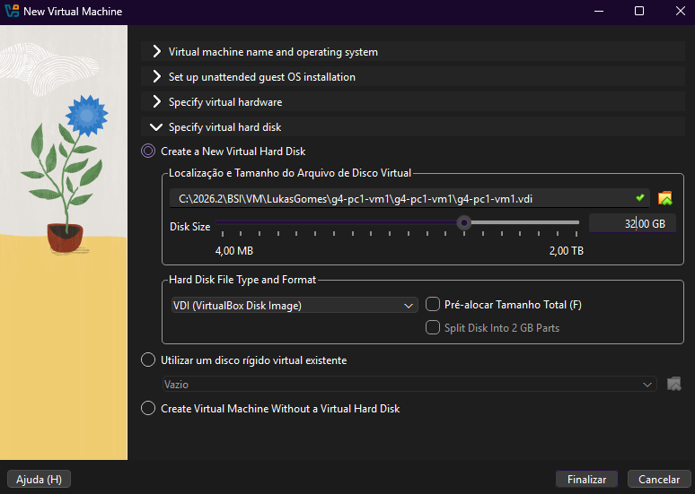
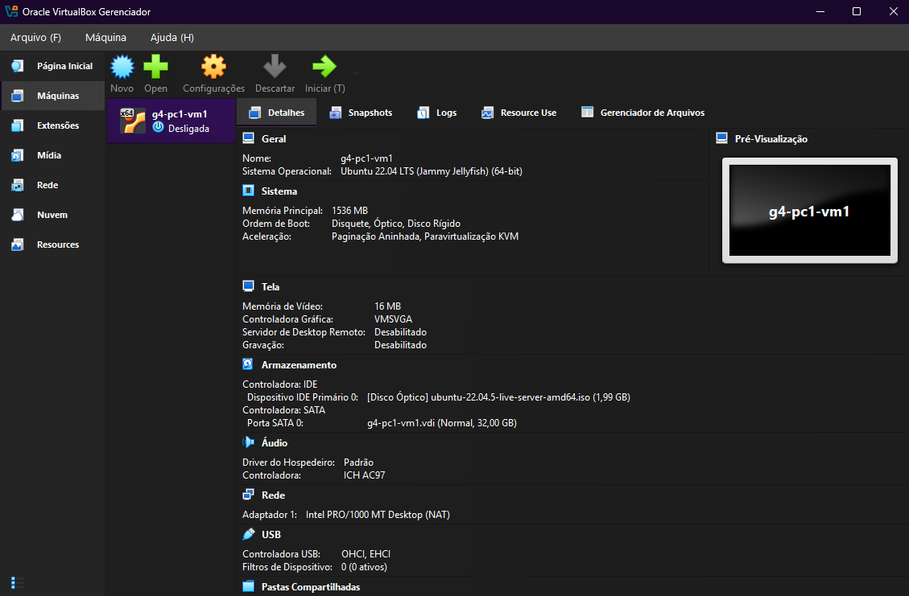

# Criação das Máquinas Virtuais

## 1. Preparação do ambiente

Inicialmente, preparamos o ambiente para a criação das máquinas virtuais, utilizando o Oracle VM VirtualBox e o Ubuntu Server 22.04.5 LTS.

A imagem ISO do Ubuntu Server foi obtida por meio do endereço:

[Ubuntu Server 22.04.5 LTS](https://releases.ubuntu.com/jammy/ubuntu-22.04.5-live-server-amd64.iso)

Após o download, organizamos os diretórios no Windows para armazenar a imagem ISO e os arquivos das máquinas virtuais.

A estrutura utilizada foi:

```text
C:\
└── 2026.2\
    └── BSI\
        └── VM\
            ├── original\
            │   └── ubuntu-22.04.5-live-server-amd64.iso
            └── NomeDoAluno\
                └── g4-pc1-vm1\
```

A pasta `original` foi utilizada para armazenar a imagem ISO do sistema operacional, enquanto a pasta `NomeDoAluno` foi destinada aos arquivos das máquinas virtuais.

## 2. Criação da primeira máquina virtual

Com o ambiente preparado, iniciamos o VirtualBox e selecionamos a opção **Novo**, disponível na tela principal do programa.

O assistente de criação apresenta seções expansíveis para configurar a identificação da máquina, o tipo de instalação, os recursos de hardware e o disco rígido virtual.

### 2.1 Nome da máquina e sistema operacional

Na seção **Virtual machine name and operating system**, preenchemos os campos de identificação da primeira máquina virtual.

As configurações utilizadas foram:

| Campo | Configuração |
|---|---|
| VM Name | `g4-pc1-vm1` |
| VM Folder | `C:\2026.2\BSI\VM\NomeDoAluno\` |
| ISO Image | `ubuntu-22.04.5-live-server-amd64.iso` |
| OS | Linux |
| OS Distribution | Ubuntu |
| OS Version | Ubuntu 22.04 LTS (Jammy Jellyfish) (64-bit) |

No campo **VM Name**, utilizamos o hostname curto definido no planejamento da rede.

Em **ISO Image**, selecionamos a imagem ISO do Ubuntu Server 22.04.5 LTS, armazenada anteriormente na pasta `original`.

Também selecionamos a distribuição Ubuntu e a versão 22.04 LTS (64-bit), correspondente ao sistema operacional que será instalado.


### 2.2 Tipo de instalação do sistema operacional

Desmarcamos a opção **Proceed with Unattended Installation**, localizada na primeira seção do assistente.

Essa alteração permite realizar a instalação do Ubuntu Server manualmente, incluindo a configuração do particionamento LVM, a criação do usuário administrador e a seleção do serviço OpenSSH Server durante a instalação.

Dessa forma, não foi necessário configurar previamente os campos de usuário, senha e domínio apresentados para a instalação automática.

### 2.3 Configuração dos recursos de hardware

Na seção **Specify virtual hardware**, definimos a quantidade de memória RAM e o número de processadores disponibilizados para a máquina virtual.

As configurações utilizadas foram:

| Recurso | Configuração |
|---|---|
| Base Memory | 1536 MB |
| Number of CPUs | 1 |
| Use EFI | Desmarcado |

Configuramos inicialmente **1536 MB de memória RAM**, para disponibilizar os recursos necessários durante a instalação do Ubuntu Server.

Após a instalação do sistema operacional e a preparação inicial, a memória será reduzida para 512 MB, permitindo executar duas máquinas virtuais simultaneamente com menor consumo de recursos.

Também definimos um processador virtual e mantivemos a opção **Use EFI** desmarcada.


### 2.4 Configuração do disco rígido virtual

Na seção **Specify virtual hard disk**, selecionamos a opção **Create a New Virtual Hard Disk**, para criar um novo disco rígido virtual destinado à instalação do Ubuntu Server.

As configurações utilizadas foram:

| Campo | Configuração |
|---|---|
| Tipo de disco | Create a New Virtual Hard Disk |
| Disk Size | 32 GB |
| Formato | VDI (VirtualBox Disk Image) |
| Pré-alocar Tamanho Total | Desmarcado |
| Split Disk Into 2 GB Parts | Desmarcado |

Definimos o tamanho do disco virtual como **32 GB** e selecionamos o formato VDI.

Mantivemos a opção **Pré-alocar Tamanho Total** desmarcada, utilizando armazenamento dinamicamente alocado.

Com essa configuração, o arquivo do disco virtual utiliza inicialmente apenas o espaço necessário e aumenta conforme os dados são armazenados, até atingir o limite estabelecido.

Também mantivemos desmarcada a opção de dividir o disco em partes de 2 GB.



### 2.5 Finalização da criação

Após configurar as quatro seções do assistente, revisamos as informações definidas para a máquina virtual.

Confirmamos o nome `g4-pc1-vm1`, a imagem ISO do Ubuntu Server 22.04.5 LTS, a memória RAM de 1536 MB, o processador único e o disco virtual VDI de 32 GB.

Em seguida, selecionamos **Finalizar** para concluir a criação da máquina virtual.

Após esse procedimento, a VM passou a aparecer na lista de máquinas do VirtualBox, pronta para iniciar a instalação do sistema operacional.



## 3. Instalação do Ubuntu Server

*Instalação manual do Ubuntu Server 22.04.5 LTS, incluindo idioma, teclado, rede, particionamento LVM, configuração do administrador e OpenSSH Server.*

## 4. Preparação inicial do sistema

*Atualização dos pacotes, instalação dos utilitários de rede, download do script de validação e redução da memória RAM para 512 MB.*

## 5. Clonagem da máquina virtual

*Clonagem da primeira VM, criação da `g4-pc1-vm2` e geração de novos endereços MAC.*

## 6. Registro das máquinas virtuais do grupo

*Evidências das oito máquinas virtuais criadas pelos integrantes do Grupo 4.*

## 7. Próxima etapa

Com as máquinas virtuais criadas e o Ubuntu Server instalado, a próxima etapa consiste na criação dos usuários dos integrantes em todas as VMs.

[⬅️ Voltar ao planejamento](01-planejamento.md) • [Avançar para criação dos usuários ➡️](03-usuarios.md)