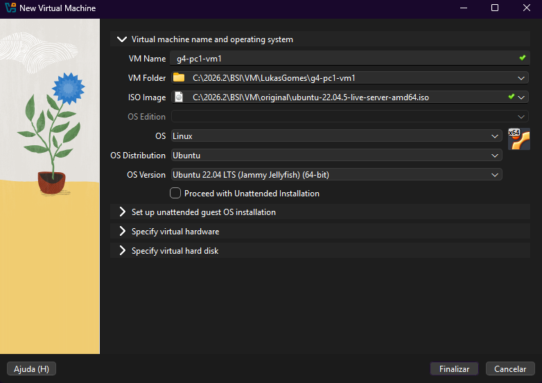
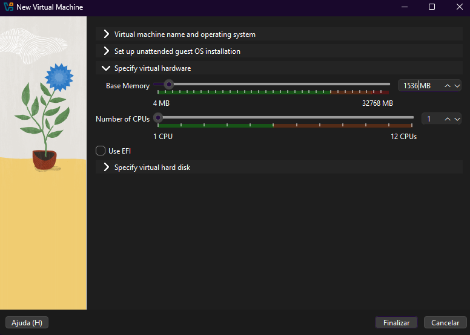

# Criação das Máquinas Virtuais

## 1. Preparação do ambiente

Inicialmente, preparamos o ambiente para a criação das máquinas virtuais, utilizando o Oracle VM VirtualBox e o Ubuntu Server 22.04.5 LTS.

A imagem ISO do Ubuntu Server foi obtida por meio do endereço:

[Ubuntu Server 22.04.5 LTS](https://releases.ubuntu.com/jammy/ubuntu-22.04.5-live-server-amd64.iso)

Após o download, organizamos os diretórios no Windows para armazenar a imagem ISO e os arquivos das máquinas virtuais.

A estrutura utilizada foi:

```text
C:\
└── 2026.2\
    └── BSI\
        └── VM\
            ├── original\
            │   └── ubuntu-22.04.5-live-server-amd64.iso
            └── NomeDoAluno\
                └── g4-pc1-vm1\
```

A pasta `original` foi utilizada para armazenar a imagem ISO do sistema operacional, enquanto a pasta `NomeDoAluno` foi destinada aos arquivos das máquinas virtuais.

## 2. Criação da primeira máquina virtual

Com o ambiente preparado, iniciamos o VirtualBox e selecionamos a opção **Novo**, disponível na tela principal do programa.

O assistente de criação apresenta seções expansíveis para configurar a identificação da máquina, o tipo de instalação, os recursos de hardware e o disco rígido virtual.

### 2.1 Nome da máquina e sistema operacional

Na seção **Virtual machine name and operating system**, preenchemos os campos de identificação da primeira máquina virtual.

As configurações utilizadas foram:

| Campo | Configuração |
|---|---|
| VM Name | `g4-pc1-vm1` |
| VM Folder | `C:\2026.2\BSI\VM\NomeDoAluno\` |
| ISO Image | `ubuntu-22.04.5-live-server-amd64.iso` |
| OS | Linux |
| OS Distribution | Ubuntu |
| OS Version | Ubuntu 22.04 LTS (Jammy Jellyfish) (64-bit) |

No campo **VM Name**, utilizamos o hostname curto definido no planejamento da rede.

Em **ISO Image**, selecionamos a imagem ISO do Ubuntu Server 22.04.5 LTS, armazenada anteriormente na pasta `original`.

Também selecionamos a distribuição Ubuntu e a versão 22.04 LTS (64-bit), correspondente ao sistema operacional que será instalado.



### 2.2 Tipo de instalação do sistema operacional

Desmarcamos a opção **Proceed with Unattended Installation**, localizada na primeira seção do assistente.

Essa alteração permite realizar a instalação do Ubuntu Server manualmente, incluindo a configuração do particionamento LVM, a criação do usuário administrador e a seleção do serviço OpenSSH Server durante a instalação.

Dessa forma, não foi necessário configurar previamente os campos de usuário, senha e domínio apresentados para a instalação automática.

### 2.3 Configuração dos recursos de hardware

Na seção **Specify virtual hardware**, definimos a quantidade de memória RAM e o número de processadores disponibilizados para a máquina virtual.

As configurações utilizadas foram:

| Recurso | Configuração |
|---|---|
| Base Memory | 1536 MB |
| Number of CPUs | 1 |
| Use EFI | Desmarcado |

Configuramos inicialmente **1536 MB de memória RAM**, para disponibilizar os recursos necessários durante a instalação do Ubuntu Server.

Após a instalação do sistema operacional e a preparação inicial, a memória será reduzida para 550 MB, permitindo executar duas máquinas virtuais simultaneamente com menor consumo de recursos.

Também definimos um processador virtual e mantivemos a opção **Use EFI** desmarcada.



### 2.4 Configuração do disco rígido virtual

Na seção **Specify virtual hard disk**, selecionamos a opção **Create a New Virtual Hard Disk**, para criar um novo disco rígido virtual destinado à instalação do Ubuntu Server.

As configurações utilizadas foram:

| Campo | Configuração |
|---|---|
| Tipo de disco | Create a New Virtual Hard Disk |
| Disk Size | 32 GB |
| Formato | VDI (VirtualBox Disk Image) |
| Pré-alocar Tamanho Total | Desmarcado |
| Split Disk Into 2 GB Parts | Desmarcado |

Definimos o tamanho do disco virtual como **32 GB** e selecionamos o formato VDI.

Mantivemos a opção **Pré-alocar Tamanho Total** desmarcada, utilizando armazenamento dinamicamente alocado.

Com essa configuração, o arquivo do disco virtual utiliza inicialmente apenas o espaço necessário e aumenta conforme os dados são armazenados, até atingir o limite estabelecido.

Também mantivemos desmarcada a opção de dividir o disco em partes de 2 GB.


### 2.5 Finalização da criação

Após configurar as quatro seções do assistente, revisamos as informações definidas para a máquina virtual.

Confirmamos o nome `g4-pc1-vm1`, a imagem ISO do Ubuntu Server 22.04.5 LTS, a memória RAM de 1536 MB, o processador único e o disco virtual VDI de 32 GB.

Em seguida, selecionamos **Finalizar** para concluir a criação da máquina virtual.

Após esse procedimento, a VM passou a aparecer na lista de máquinas do VirtualBox, pronta para iniciar a instalação do sistema operacional.


## 3. Instalação do Ubuntu Server

Com a primeira máquina virtual criada, iniciamos a VM no VirtualBox pela imagem ISO e instalamos manualmente o Ubuntu Server 22.04.5 LTS.

### 3.1 Inicialização e configuração do teclado

No menu de inicialização, selecionamos **Try or Install Ubuntu Server**.


Na tela de boas-vindas, selecionamos **English** como idioma do instalador.


Quando o instalador ofereceu uma atualização, selecionamos **Continue without updating** para prosseguir com a versão incluída na ISO.


Em **Keyboard configuration**, selecionamos **Portuguese (Brazil)** nos campos **Layout** e **Variant** e confirmamos em **Done**.


### 3.2 Tipo de instalação e configuração de rede

Na tela **Choose the type of installation**, mantivemos **Ubuntu Server** selecionado e confirmamos em **Done**.

Em **Network configuration**, mantivemos a configuração apresentada pelo instalador. Na tela de proxy, deixamos o campo **Proxy address** em branco. Em **Ubuntu archive mirror configuration**, mantivemos o espelho de repositórios apresentado. Confirmamos cada tela em **Done**.

### 3.3 Particionamento do disco virtual

Na tela **Guided storage configuration**, selecionamos **Custom storage layout** e confirmamos em **Done** para definir manualmente as partições do disco virtual de 32 GB.


Na tela **Storage configuration**, selecionamos **free space** no disco virtual e escolhemos **Add GPT Partition**.


Criamos a partição de inicialização com tamanho de `1G`, formato `ext4` e ponto de montagem `/boot). Confirmamos em **Create**.


No espaço restante, selecionamos novamente **Add GPT Partition**. Usamos `30.997G`, selecionamos **Leave unformatted** e confirmamos em **Create**. Essa partição seria usada pelo LVM.


### 3.4 Criação do grupo LVM e dos volumes lógicos

Com as partições criadas, selecionamos **Create volume group (LVM)**.


Definimos o nome do grupo como `ubuntu-vg`, marcamos **partition 3** como dispositivo e confirmamos em **Create**. O instalador mostrou `30.996G` disponíveis no grupo.


Em `ubuntu-vg`, criamos os volumes lógicos com as configurações abaixo.

| Volume lógico | Tamanho | Formato | Ponto de montagem |
|---|---|---|---|
| `ubuntu-lv` | `29G` | `ext4` | `/` |
| `swap-lv` | `1.996G` | `swap` | — |

Criamos primeiro `ubuntu-lv` para o sistema de arquivos raiz. Em seguida, usamos o espaço restante para criar `swap-lv` como área de troca.


Revisamos o resumo do armazenamento e conferimos as entradas para `/`, `/boot` e `SWAP`. O instalador também mostrou a partição de `1.000M` reservada para o GRUB em modo BIOS. Selecionamos **Done** e, na tela de confirmação, **Continue** para aplicar as alterações ao disco virtual.


### 3.5 Configuração do perfil e dos serviços

Em **Profile configuration**, preenchemos os dados do administrador e identificamos o servidor com o hostname curto definido no planejamento da rede.

| Campo | Configuração |
|---|---|
| Your name | `Administrador` |
| Your servers name | nome do servidor (g2-pc2-vm1)|
| Pick a username | `administrador` |
| Choose a password | adminifal |
| Confirm your password | adminifal |

Confirmamos o perfil em **Done**. A captura mostra o preenchimento na VM `g4-pc2-vm1`. Para a VM criada na seção anterior, o hostname correspondente é `g4-pc1-vm1`.


Na tela **Upgrade to Ubuntu Pro**, selecionamos **Skip for now** e avançamos em **Continue**.


Na configuração do SSH, marcamos **Install OpenSSH server** para permitir o acesso remoto à VM e confirmamos em **Done**.

Em **Featured server snaps**, deixamos todos os pacotes opcionais desmarcados e selecionamos **Done**.


### 3.6 Conclusão da instalação

Aguardamos a conclusão da instalação e selecionamos **Reboot Now** para reiniciar a máquina virtual. Após o reinício, seguimos para a preparação inicial do sistema.

## 4. Preparação inicial do sistema

### 4.1 Primeiro acesso e atualização da lista de pacotes

Após o reinício, aguardamos a tela de login do Ubuntu Server. Entramos com o usuário `administrador` e a senha definida durante a instalação.


No terminal, executamos o comando abaixo para atualizar a lista de pacotes disponíveis nos repositórios configurados.

```bash
sudo apt-get update
```


### 4.2 Ajuste da memória RAM no VirtualBox

Após a atualização da lista de pacotes, desligamos a máquina virtual pelo terminal.

```bash
sudo poweroff
```

Com a VM desligada, abrimos **Configurações** no VirtualBox. Em **Sistema**, na aba **Placa-Mãe**, alteramos **Base Memory** para **550 MB** e confirmamos em **OK**.

**Observação.** Com 512 MB de RAM, o Ubuntu Server apresentava um *kernel panic*. Por isso, aumentamos a memória da VM para 550 MB.


### 4.3 Verificação da memória no Ubuntu Server

Ligamos a VM novamente, entramos com o usuário `administrador` e executamos o comando abaixo.

```bash
free -h
```

Na linha `Mem:`, consultamos a coluna `total` para ver a memória reconhecida pelo Ubuntu e a coluna `available` para conferir quanto estava disponível.

## 5. Clonagem da máquina virtual

*Clonagem da primeira VM, criação da `g4-pc1-vm2` e geração de novos endereços MAC.*

## 6. Registro das máquinas virtuais do grupo

*Evidências das oito máquinas virtuais criadas pelos integrantes do Grupo 4.*

## 7. Próxima etapa

Com as máquinas virtuais criadas e o Ubuntu Server instalado, a próxima etapa consiste na criação dos usuários dos integrantes em todas as VMs.

[⬅️ Voltar ao planejamento](01-planejamento.md) • [Avançar para criação dos usuários ➡️](03-usuarios.md)