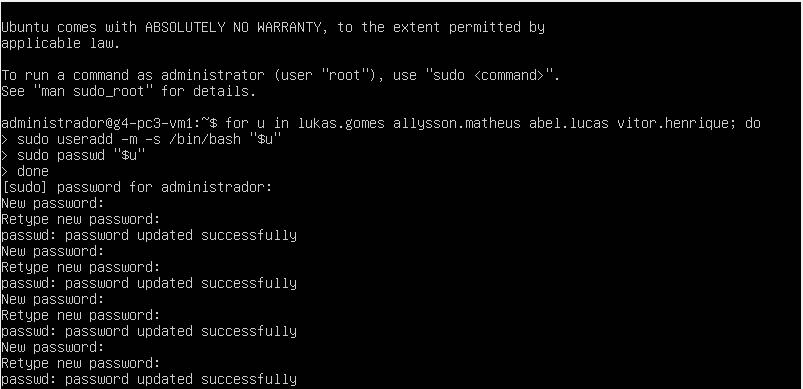
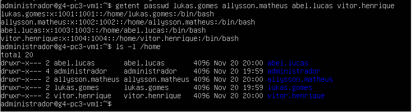
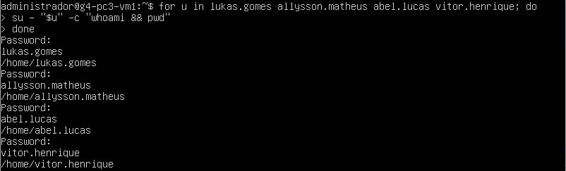

# Criação e Validação dos Usuários — Grupo 4

## 1. Padronização e planejamento

Em todas as 8 máquinas virtuais do Grupo 4 (`g4-pc1-vm1` a `g4-pc4-vm2`), além da conta `administrador` configurada na instalação do Ubuntu Server, foram criados usuários individuais para cada integrante da equipe.

Seguindo as normas do projeto, todos os nomes de usuário obedecem ao formato `nome.sobrenome` (em letras minúsculas, sem espaços e sem acentos), possuem diretório pessoal em `/home/<usuário>` e utilizam o interpretador de comandos `/bin/bash`:

| Integrante | Usuário | Diretório Home | Shell | Senha Padrão |
| :--- | :--- | :--- | :--- | :--- |
| Lukas Gomes | `lukas.gomes` | `/home/lukas.gomes` | `/bin/bash` | `ifal123` |
| Allysson Matheus | `allysson.matheus` | `/home/allysson.matheus` | `/bin/bash` | `ifal123` |
| Abel Lucas | `abel.lucas` | `/home/abel.lucas` | `/bin/bash` | `ifal123` |
| Vitor Henrique | `vitor.henrique` | `/home/vitor.henrique` | `/bin/bash` | `ifal123` |

---

## 2. Criação em lote e definição de senhas

Para agilizar a configuração e evitar erros de digitação nas 8 máquinas virtuais, utilizamos uma estrutura de repetição (`for`) no terminal Bash. O comando `useradd -m -s /bin/bash` cria o usuário juntamente com sua pasta pessoal (`-m`) e define o shell padrão (`-s`), enquanto o `passwd` solicita imediatamente a definição da senha de cada conta.

**Comando executado:**

```bash
for u in lukas.gomes allysson.matheus abel.lucas vitor.henrique; do
  sudo useradd -m -s /bin/bash "$u"
  sudo passwd "$u"
done
```

> **Comportamento durante a execução:** Ao iniciar o laço, o sistema solicita a senha do usuário `administrador` para autorizar o `sudo`. Em seguida, pede interativamente a nova senha (`New password:`) e a confirmação (`Retype new password:`) para cada um dos quatro integrantes. Para padronizar os testes de acesso remoto via SSH entre as VMs, adotamos a senha **`ifal123`** para todos os usuários.

**Evidência (`g4-pc3-vm1` — recorte da criação e atualização de senhas):**



---

## 3. Verificação das contas e diretórios `/home`

Após a criação, validamos se os registros foram gravados corretamente no banco de contas do sistema (`/etc/passwd`) por meio do utilitário `getent passwd` e conferimos se os diretórios pessoais foram gerados com as permissões adequadas dentro de `/home`.

**Comandos executados:**

```bash
getent passwd lukas.gomes allysson.matheus abel.lucas vitor.henrique
ls -l /home
```

**Evidência (`g4-pc3-vm1` — recorte da consulta ao passwd e listagem do /home):**



---

## 4. Testes de autenticação e ambiente dos usuários

Conforme orientado no Roteiro 02, realizamos testes práticos de troca de sessão local utilizando o comando `su - <usuário>`. O uso do hífen (`-`) é fundamental porque inicia uma sessão de login completa (*Login Shell*), limpando as variáveis do `administrador` e posicionando o usuário diretamente em seu próprio diretório `/home/<usuário>`.

Em cada sessão aberta, executamos `whoami` (para confirmar a identidade ativa) e `pwd` (para confirmar o carregamento do diretório pessoal correto), encerrando com `exit` para retornar ao administrador:

**Comandos executados:**

```bash
su - lukas.gomes
whoami && pwd
exit

su - allysson.matheus
whoami && pwd
exit

su - abel.lucas
whoami && pwd
exit

su - vitor.henrique
whoami && pwd
exit
```

**Evidência (`g4-pc3-vm1` — testando o login dos 4 usuários):**



---

## 5. Replicação nas demais máquinas virtuais

Para agilizar a implantação do ambiente no laboratório, os usuários criados e validados na VM matriz (`g4-pc3-vm1`) foram replicados para as demais máquinas virtuais do Grupo 4 por meio do processo de **clonagem no VirtualBox** (detalhado em [02-criacao-das-vms.md](02-criacao-das-vms.md)).

Como a clonagem copia integralmente o sistema de arquivos e o banco de contas (`/etc/passwd`, `/etc/shadow` e diretórios `/home`), todas as 8 VMs (`g4-pc1-vm1` a `g4-pc4-vm2`) passaram a contar exatamente com o mesmo conjunto de usuários e senhas padronizadas, sem necessidade de repetir os comandos manualmente em cada máquina. A presença e a integridade dessas contas em toda a sub-rede `192.168.26.64/28` são confirmadas nos relatórios individuais gerados pelo script de validação na pasta `validacao/`.

---

[⬅️ Voltar para criação das VMs](02-criacao-das-vms.md) • [Avançar para rede e Netplan ➡️](04-rede-netplan.md)