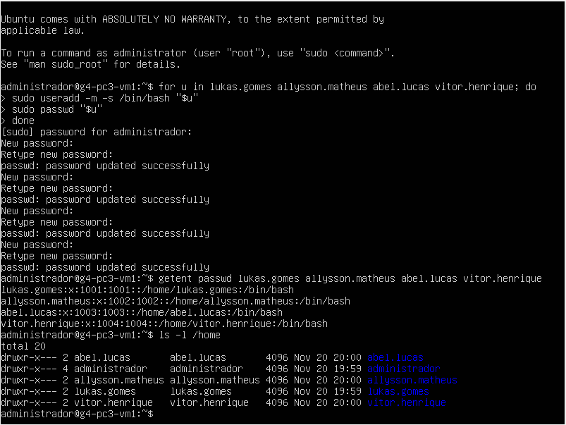

# Usuários
# Criação dos Usuários — Grupo 4

## 1. Padronização adotada

Em todas as 8 máquinas virtuais do Grupo 4 (`g4-pc1-vm1` a `g4-pc4-vm2`), além do usuário `administrador`, foram criados usuários individuais para cada integrante do grupo.

Os usuários seguem o formato `nome.sobrenome` (letras minúsculas, sem espaços e sem acentos), com diretório pessoal em `/home/<usuário>` e shell `/bin/bash`:

| Integrante | Usuário | Diretório Home | Shell |
|---|---|---|---|
| Lukas Gomes | `lukas.gomes` | `/home/lukas.gomes` | `/bin/bash` |
| Allysson Matheus | `allysson.matheus` | `/home/allysson.matheus` | `/bin/bash` |
| Abel Lucas | `abel.lucas` | `/home/abel.lucas` | `/bin/bash` |
| Vitor Henrique | `vitor.henrique` | `/home/vitor.henrique` | `/bin/bash` |

## 2. Comandos executados

Em cada VM, foi executado o seguinte bloco de comandos para criar os usuários em lote e definir suas respectivas senhas:

```bash
for u in lukas.gomes allysson.matheus abel.lucas vitor.henrique; do
  sudo useradd -m -s /bin/bash "$u"
  sudo passwd "$u"
done
```

> **Observação sobre a definição de senhas:** Ao executar o bloco acima, o terminal solicita primeiramente a senha do usuário `administrador` (devido ao `sudo`) e, em seguida, pede interativamente a nova senha (`New password:`) e a confirmação (`Retype new password:`) para cada um dos quatro usuários. Para padronizar e facilitar os testes entre as máquinas do grupo, adotamos a senha **`ifal123`** para todos os usuários criados.

Para validar a criação das contas, os diretórios pessoais em `/home` e o shell `/bin/bash`, foram executados os seguintes comandos de verificação:

```bash
getent passwd lukas.gomes allysson.matheus abel.lucas vitor.henrique
ls -l /home
```

### Teste de Acesso aos Usuários Criados

Para garantir que as contas foram criadas com as senhas corretas e estão funcionando no sistema, realizamos o teste de login local utilizando o comando `su - <usuario>` para iniciar uma sessão limpa.

```bash
su - lukas.gomes
exit
```

## 3. Evidências e saídas obtidas

### Saída no terminal (`g4-pc3-vm1`)

```text
administrador@g4-pc3-vm1:~$ getent passwd lukas.gomes allysson.matheus abel.lucas vitor.henrique
lukas.gomes:x:1001:1001::/home/lukas.gomes:/bin/bash
allysson.matheus:x:1002:1002::/home/allysson.matheus:/bin/bash
abel.lucas:x:1003:1003::/home/abel.lucas:/bin/bash
vitor.henrique:x:1004:1004::/home/vitor.henrique:/bin/bash
administrador@g4-pc3-vm1:~$ ls -l /home
total 20
drwxr-x--- 2 abel.lucas       abel.lucas       4096 Nov 20 20:00 abel.lucas
drwxr-x--- 4 administrador    administrador    4096 Nov 20 19:59 administrador
drwxr-x--- 2 allysson.matheus allysson.matheus 4096 Nov 20 20:00 allysson.matheus
drwxr-x--- 2 lukas.gomes      lukas.gomes      4096 Nov 20 19:59 lukas.gomes
drwxr-x--- 2 vitor.henrique   vitor.henrique   4096 Nov 20 20:00 vitor.henrique
```

### Capturas de tela



---

[⬅️ Voltar para criação das VMs](02-criacao-das-vms.md) • [Avançar para rede e Netplan ➡️](04-rede-netplan.md)