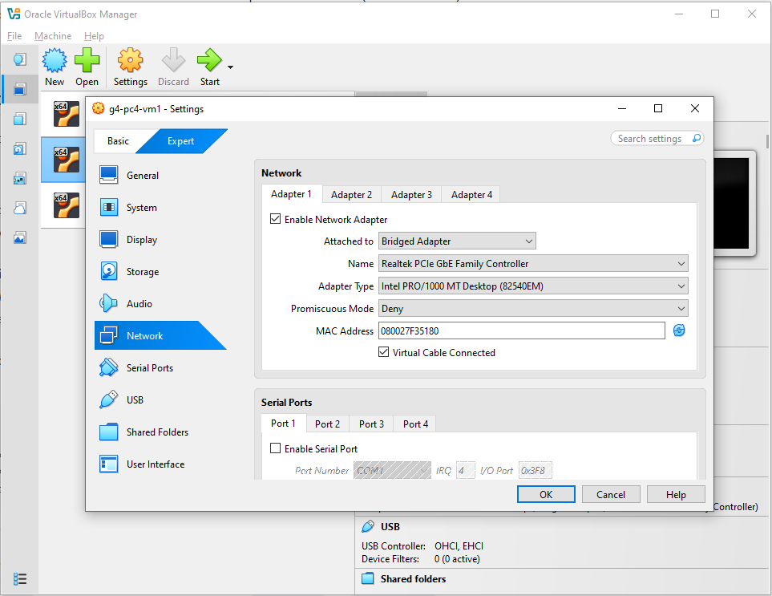
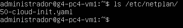
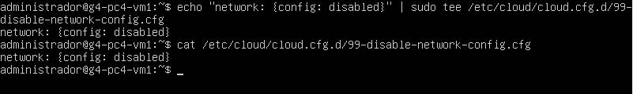
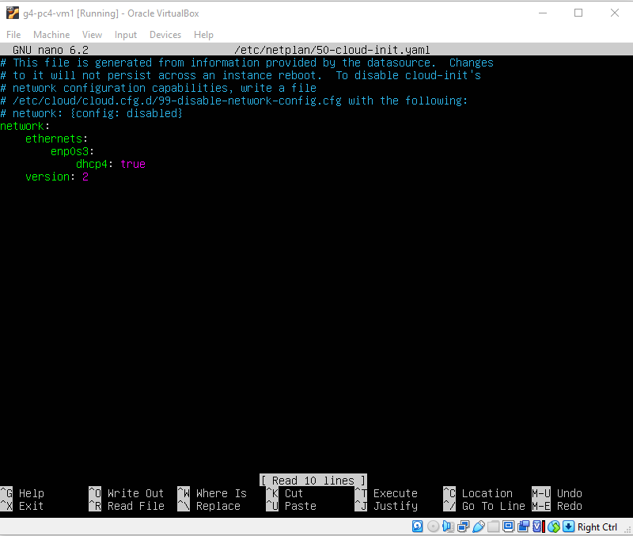
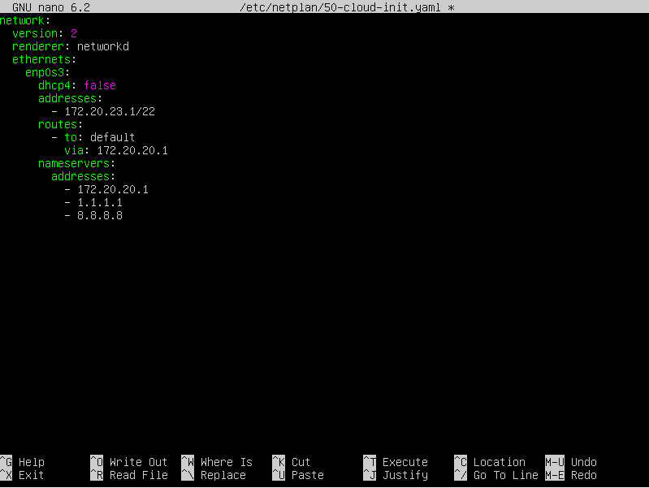
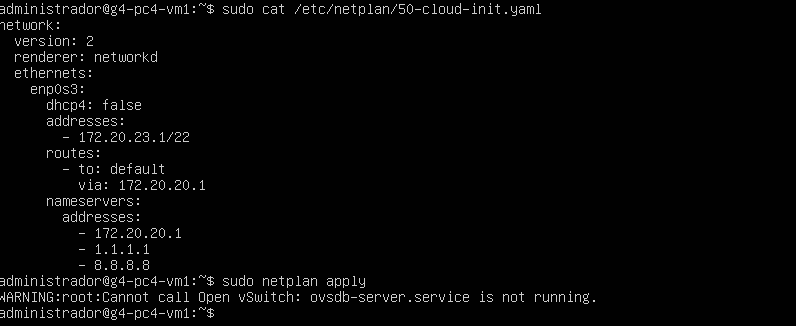
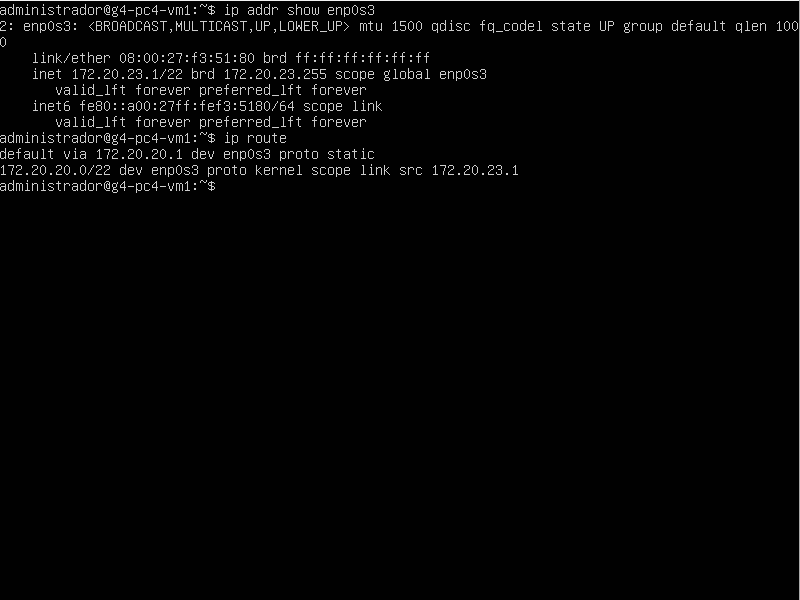

# Configuração de Rede em Modo Ponte e IP Estático — Grupo 4
 
## 1. Padronização e planejamento
 
Por padrão, o VirtualBox cria as máquinas virtuais com o adaptador de rede em modo **NAT**. Nesse modo, a VM fica isolada atrás de um roteador virtual interno, com o IP privado `10.0.2.15`, e não pode ser acessada diretamente pelas outras máquinas do laboratório. Para que as VMs do Grupo 4 participem da rede física do IFAL, trocamos o adaptador para o modo **Placa em Ponte (Bridged Adapter)** e configuramos um **endereço IP estático** com o **Netplan**, o gerenciador de rede do Ubuntu Server.
 
Todas as VMs usam a interface `enp0s3`, com os parâmetros de rede do laboratório (`172.20.20.0/22`).
 
| Parâmetro | Valor |
| :--- | :--- |
| Máquina virtual | `g4-pc4-vm1` |
| Interface | `enp0s3` |
| Modo do adaptador | Placa em Ponte (Bridged Adapter) |
| Placa física do host | Realtek PCIe GbE Family Controller |
| Endereço IP | `172.20.23.1/22` |
| Máscara de sub-rede | `255.255.252.0` |
| Gateway padrão | `172.20.20.1` |
| Servidores DNS | `172.20.20.1`, `1.1.1.1`, `8.8.8.8` |
| Arquivo do Netplan | `/etc/netplan/50-cloud-init.yaml` |
 
> **Atenção:** a faixa `172.20.20.0/22` só existe na rede do laboratório. Fora dela, a VM não alcança o gateway, e os testes de IP livre e de conectividade dão resultados falsos.
 
---
 
## 2. Adaptador de rede em modo ponte no VirtualBox
 
Antes de mexer na configuração do Ubuntu, alteramos a placa de rede virtual no próprio VirtualBox. No modo ponte, a interface `enp0s3` da VM é ligada diretamente à placa de rede física do computador hospedeiro. Assim, a VM passa a se comportar como mais um computador conectado ao switch do laboratório.
 
**Configuração aplicada** (*Settings → Network → Adapter 1*):
 
* **Enable Network Adapter:** marcado
* **Attached to:** `Bridged Adapter` (Placa em Ponte)
* **Name:** `Realtek PCIe GbE Family Controller` (placa física do PC4 ligada ao cabo de rede)
* **Virtual Cable Connected:** marcado
> **Observação:** como as VMs do grupo foram clonadas, conferimos se cada uma tem um **MAC Address** diferente (na `g4-pc4-vm1`: `080027F35180`). No modo ponte, todas as VMs ficam na mesma rede física, e um MAC repetido causa falhas de comunicação.
 
**Evidência (`g4-pc4-vm1` — adaptador 1 em modo Bridged Adapter):**
 

 
---
 
## 3. Verificação de endereço IP livre
 
A rede do laboratório (`172.20.20.0/22`) vai de `172.20.20.1` até `172.20.23.254`. Para não entrar em conflito com outros equipamentos, usamos a faixa a partir de `172.20.23.1`. Antes de configurar o endereço na VM, verificamos pelo **PowerShell do Windows (host)** se ele já estava em uso, com um `ping`.
 
**Comando executado:**
 
```powershell
ping 172.20.23.1
```
 
> **Comportamento durante a execução:** quando nenhuma máquina usa o endereço, o Windows mostra `Request timed out` nas 4 tentativas e termina com `Lost = 4 (100% loss)`, ou seja, o IP está livre. Se houver resposta (`Reply from 172.20.23.1...`), o endereço já está ocupado, e o teste deve ser repetido com o próximo (`172.20.23.2`, `172.20.23.3`…).
 
**Evidência (PC4 — teste de disponibilidade do IP `172.20.23.1`):**
 
<!-- PENDENTE (laboratório): print do PowerShell do PC4 com `ping 172.20.23.1` mostrando os 4 "Request timed out" e "Lost = 4 (100% loss)". -->

 
---
 
## 4. Preparação do Netplan
 
O Netplan lê a configuração de rede a partir de arquivos YAML na pasta `/etc/netplan/`. Listando essa pasta, identificamos que o instalador do Ubuntu Server havia criado o arquivo **`50-cloud-init.yaml`**.
 
Esse arquivo é gerado pelo **cloud-init**, que pode reescrevê-lo durante a inicialização do sistema e desfazer a configuração estática. Por isso, seguindo a instrução do próprio comentário no topo do arquivo, desativamos a configuração de rede do cloud-init. Para isso, criamos o arquivo `99-disable-network-config.cfg` com o comando `tee`, que grava a saída do `echo` em um arquivo protegido usando `sudo`. Depois, conferimos o conteúdo com `cat`.
 
**Comandos executados:**
 
```bash
ls /etc/netplan/
echo "network: {config: disabled}" | sudo tee /etc/cloud/cloud.cfg.d/99-disable-network-config.cfg
cat /etc/cloud/cloud.cfg.d/99-disable-network-config.cfg
```
 
**Evidência (`g4-pc4-vm1` — arquivo de configuração do Netplan):**
 

 
**Evidência (`g4-pc4-vm1` — desativação da rede do cloud-init):**
 

 
---
 
## 5. Configuração do IP estático
 
Abrimos o arquivo `50-cloud-init.yaml` no editor `nano`, com privilégios de administrador. A configuração original definia apenas `dhcp4: true`, ou seja, a interface `enp0s3` recebia IP automaticamente.
 
**Comando executado:**
 
```bash
sudo nano /etc/netplan/50-cloud-init.yaml
```
 
**Evidência (`g4-pc4-vm1` — arquivo original, com DHCP):**
 

 
Apagamos o conteúdo original e escrevemos a configuração estática. Nela, `dhcp4: false` desativa o DHCP, `addresses` define o IP e a máscara em notação CIDR (`/22`), `routes` define o gateway padrão (`to: default`), e `nameservers` lista os servidores DNS. Como o YAML depende da indentação, usamos **2 espaços por nível**, sem `Tab`:
 
```yaml
network:
  version: 2
  renderer: networkd
  ethernets:
    enp0s3:
      dhcp4: false
      addresses:
        - 172.20.23.1/22
      routes:
        - to: default
          via: 172.20.20.1
      nameservers:
        addresses:
          - 172.20.20.1
          - 1.1.1.1
          - 8.8.8.8
```
 
**Evidência (`g4-pc4-vm1` — arquivo editado com IP estático):**
 

 
Após salvar (`Ctrl + O`, `Enter`) e sair (`Ctrl + X`), conferimos o conteúdo do arquivo e aplicamos a nova configuração com o `netplan apply`.
 
**Comandos executados:**
 
```bash
sudo cat /etc/netplan/50-cloud-init.yaml
sudo netplan apply
```
 
> **Comportamento durante a execução:** o `netplan apply` exibiu o aviso `WARNING:root:Cannot call Open vSwitch: ovsdb-server.service is not running.`. Esse aviso pode ser ignorado: o Netplan tenta consultar o Open vSwitch (um switch virtual que esta rede não usa) mesmo quando ele não está instalado. A configuração foi aplicada normalmente.
 
**Evidência (`g4-pc4-vm1` — conferência e aplicação da configuração):**
 

 
---
 
## 6. Verificação do endereço e das rotas
 
Para confirmar que a configuração foi aplicada, consultamos a interface com o `ip addr show` e a tabela de rotas com o `ip route`.
 
**Comandos executados:**
 
```bash
ip addr show enp0s3
ip route
```
 
> **Comportamento durante a execução:** a interface `enp0s3` aparece com estado `UP` e endereço `inet 172.20.23.1/22`, e a rota padrão aparece como `default via 172.20.20.1 dev enp0s3 proto static`. O MAC mostrado em `link/ether` (`08:00:27:f3:51:80`) é o mesmo configurado no VirtualBox, o que confirma que a interface configurada é a placa em ponte.
 
**Evidência (`g4-pc4-vm1` — endereço IP e rotas aplicados):**
 

 
---
 
## 7. Testes de conectividade
 
Com a VM configurada, fizemos testes nos dois sentidos entre o host (Windows) e a VM, e testes de saída para a internet com o `traceroute`. O `traceroute` mostra cada roteador (*salto*) pelo caminho até o destino.
 
### 7.1 Ping do host para a VM
 
O mesmo `ping` da Seção 3 foi repetido no PowerShell do PC4. Agora a VM ocupa o endereço e deve responder.
 
**Comando executado:**
 
```powershell
ping 172.20.23.1
```
 
**Evidência (PC4 — ping do host para a `g4-pc4-vm1`):**
 
<!-- PENDENTE (laboratório): print do PowerShell com `ping 172.20.23.1` respondendo, 0% de perda. -->

 
### 7.2 Ping da VM para o host
 
Primeiro, consultamos o IP do PC4 com o `ipconfig` (campo *IPv4 Address* do adaptador Ethernet). Depois, fizemos o `ping` a partir da VM. A opção `-c 4` limita o teste a 4 pacotes, igual ao comportamento padrão do Windows.
 
**Comandos executados:**
 
```powershell
ipconfig
```
 
```bash
ping -c 4 <IP_do_PC4>
```
 
> **Observação:** o firewall do Windows bloqueia o ping de entrada por padrão. Se a VM não receber respostas, a regra de ICMP precisa ser liberada no host.
 
**Evidência (PC4 — endereço IP do host):**
 
<!-- PENDENTE (laboratório): print do ipconfig destacando o IPv4 do adaptador Ethernet, na faixa 172.20.20.x a 172.20.23.x. -->

 
**Evidência (`g4-pc4-vm1` — ping da VM para o host):**
 
<!-- PENDENTE (laboratório): print da VM com `ping -c 4 <IP_do_PC4>`, 0% packet loss. -->

 
 
---
 
[Voltar para criação dos usuários](03-usuarios.md)
