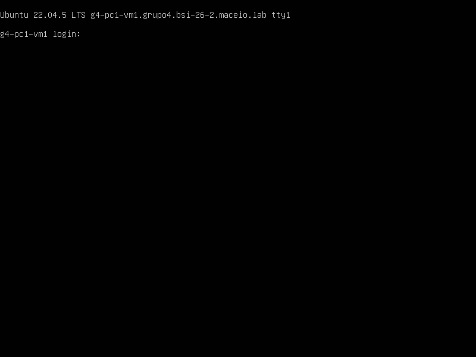
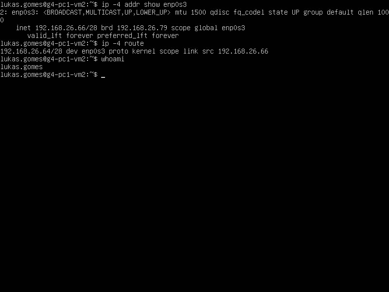
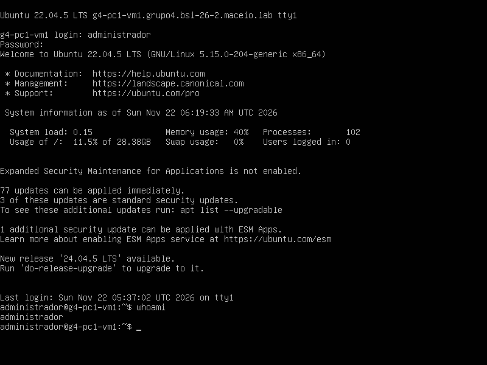
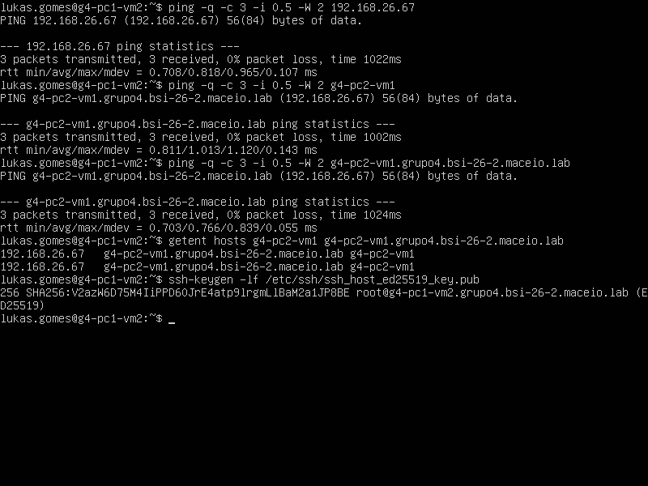
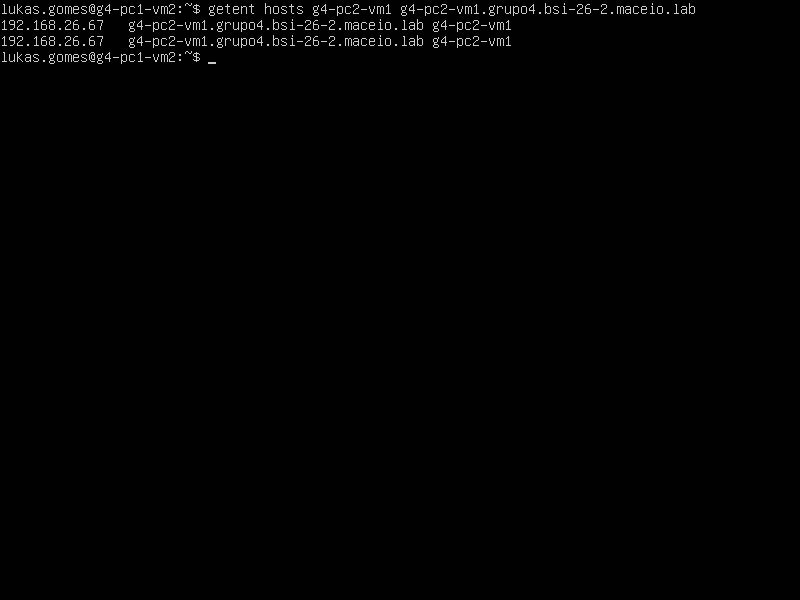
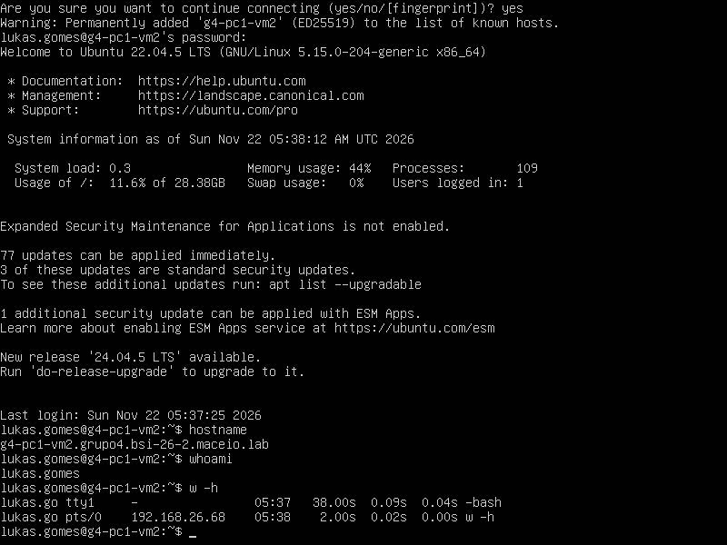
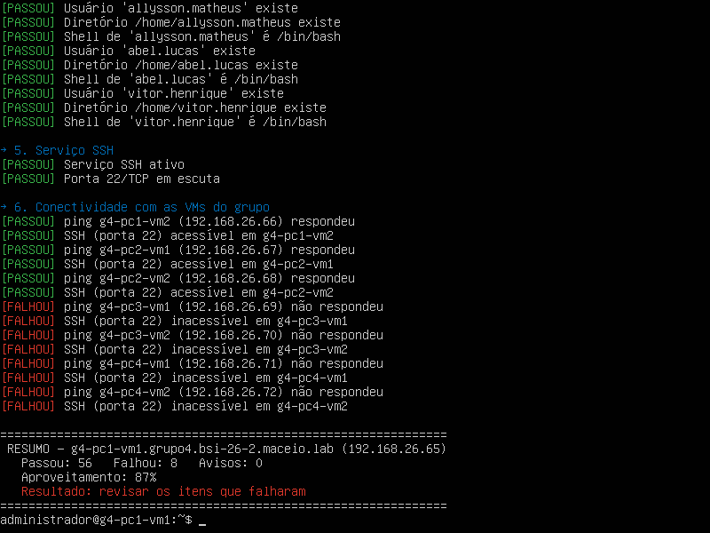

# Testes de Conectividade

## 1. Preparação do ambiente

1. No VirtualBox, ligue as quatro VMs da tabela e aguarde a tela de login em cada uma.

   

   Aguarde até aparecer `login:` ao lado do nome da VM, como na captura da `g4-pc1-vm1`.

2. No Gerenciador do VirtualBox, selecione cada VM e abra **Configurações → Rede → Adaptador 1**. Confira **Conectado a: Placa em Ponte** e **Nome: Realtek PCIe GbE Family Controller #3**.
3. Abra o console da VM indicada em cada teste e entre com uma conta do grupo. No Ubuntu, confirme o IP e a rota com os comandos abaixo. Use `whoami` para conferir a conta atual.

   ```bash
   ip -4 addr show enp0s3
   ip -4 route
   whoami
   ```

   

   Na captura, a linha `inet` mostra `192.168.26.66/28`. A tabela de rotas mostra `192.168.26.64/28 dev enp0s3` e, como não há linha começando com `default`, a VM está sem gateway IPv4. Compare o IP de cada VM com a tabela abaixo.

4. Antes de rodar o script de validação, digite `exit` se estiver usando uma conta do grupo. Entre como `administrador` e execute `whoami`. A saída deve mostrar `administrador`, como na captura.

   

| Máquina virtual | IPv4 | FQDN |
|---|---|---|
| `g4-pc1-vm1` | `192.168.26.65/28` | `g4-pc1-vm1.grupo4.bsi-26-2.maceio.lab` |
| `g4-pc1-vm2` | `192.168.26.66/28` | `g4-pc1-vm2.grupo4.bsi-26-2.maceio.lab` |
| `g4-pc2-vm1` | `192.168.26.67/28` | `g4-pc2-vm1.grupo4.bsi-26-2.maceio.lab` |
| `g4-pc2-vm2` | `192.168.26.68/28` | `g4-pc2-vm2.grupo4.bsi-26-2.maceio.lab` |

## 2. Testes de ping

### 2.1 Envio por IP, nome curto e FQDN

1. No VirtualBox, abra o console da `g4-pc1-vm2` e entre como `lukas.gomes`.
2. Digite os comandos abaixo, um por vez, e espere aparecer a estatística de cada `ping`. Os comandos usam, nesta ordem, o IP, o nome curto e o FQDN da `g4-pc2-vm1`.

```bash
ping -q -c 3 -i 0.5 -W 2 192.168.26.67
ping -q -c 3 -i 0.5 -W 2 g4-pc2-vm1
ping -q -c 3 -i 0.5 -W 2 g4-pc2-vm1.grupo4.bsi-26-2.maceio.lab
```



3. Confira se cada saída mostra `3 received, 0% packet loss`, como na captura.

### 2.2 Repetição nas quatro VMs

Siga uma linha da tabela por vez. Abra a VM da coluna **Origem** e repita os três comandos da seção 2.1, usando o IP, o nome curto e o FQDN da VM da coluna **Destino**. Use o IP da seção 1 sem o sufixo `/28`. As últimas três colunas mostram o resultado obtido em cada teste.

| Origem | Destino | Por IP | Por nome curto | Por FQDN |
|---|---|---|---|---|
| `g4-pc1-vm1` | `g4-pc1-vm2` | 3/3 | 3/3 | 3/3 |
| `g4-pc1-vm1` | `g4-pc2-vm1` | 3/3 | 3/3 | 3/3 |
| `g4-pc1-vm1` | `g4-pc2-vm2` | 3/3 | 3/3 | 3/3 |
| `g4-pc1-vm2` | `g4-pc1-vm1` | 3/3 | 3/3 | 3/3 |
| `g4-pc1-vm2` | `g4-pc2-vm1` | 3/3 | 3/3 | 3/3 |
| `g4-pc1-vm2` | `g4-pc2-vm2` | 3/3 | 3/3 | 3/3 |
| `g4-pc2-vm1` | `g4-pc1-vm1` | 3/3 | 3/3 | 3/3 |
| `g4-pc2-vm1` | `g4-pc1-vm2` | 3/3 | 3/3 | 3/3 |
| `g4-pc2-vm1` | `g4-pc2-vm2` | 3/3 | 3/3 | 3/3 |
| `g4-pc2-vm2` | `g4-pc1-vm1` | 3/3 | 3/3 | 3/3 |
| `g4-pc2-vm2` | `g4-pc1-vm2` | 3/3 | 3/3 | 3/3 |
| `g4-pc2-vm2` | `g4-pc2-vm1` | 3/3 | 3/3 | 3/3 |

Nos 36 comandos, enviamos 108 pacotes e recebemos todos.

## 3. Resolução de nomes

1. Volte ao console da `g4-pc1-vm2` e, com a conta `lukas.gomes`, execute o comando abaixo.

```bash
getent hosts g4-pc2-vm1 g4-pc2-vm1.grupo4.bsi-26-2.maceio.lab
```



2. Confira se as duas linhas mostram `192.168.26.67`.
3. Siga os pares de origem e destino da seção 2.2. Em cada par, rode `getent hosts` com o nome curto e o FQDN do destino e compare o resultado com o IP da seção 1. O teste local retornou os endereços previstos nas 24 consultas.

## 4. Acesso por SSH

### 4.1 Login remoto

1. Abra o console da `g4-pc2-vm2` e execute a primeira linha do bloco para se conectar como `lukas.gomes` à `g4-pc1-vm2`.
2. Se o SSH pedir confirmação da chave, abra o console da VM de destino e execute `ssh-keygen -lf /etc/ssh/ssh_host_ed25519_key.pub`. Compare a impressão digital com a mostrada na VM de origem. Se forem iguais, digite `yes` na origem. A opção `UserKnownHostsFile=/dev/null` faz a confirmação valer apenas para esse teste.
3. Quando o SSH pedir a senha, digite no próprio terminal a senha da conta `lukas.gomes` na VM de destino. Depois do login, execute `hostname`, `whoami` e `w -h` na sessão remota.

```bash
ssh -l lukas.gomes -o StrictHostKeyChecking=ask -o UserKnownHostsFile=/dev/null -o HostKeyAlgorithms=ssh-ed25519 g4-pc1-vm2
hostname
whoami
w -h
```



4. Confira os três dados mostrados na captura. O `hostname` deve indicar a `g4-pc1-vm2`, o `whoami` deve retornar `lukas.gomes` e o `w -h` deve mostrar `192.168.26.68` na sessão remota (`pts`). Depois de conferir a saída, digite `exit` para voltar à VM de origem.

### 4.2 Repetição com as contas do grupo

Teste os dois trajetos da tabela. Em cada um, faça quatro logins. Na primeira linha do comando SSH, substitua o nome depois de `-l` por `lukas.gomes`, `allysson.matheus`, `abel.lucas` ou `vitor.henrique`. Use o nome da VM da coluna **Destino** como último argumento. Confira o hostname, a conta e o IP de origem antes de sair de cada sessão.

| Origem | Destino | Sessões autenticadas |
|---|---|---:|
| `g4-pc1-vm1` (`192.168.26.65`) | `g4-pc2-vm1` (`192.168.26.67`) | 4/4 |
| `g4-pc2-vm2` (`192.168.26.68`) | `g4-pc1-vm2` (`192.168.26.66`) | 4/4 |

## 5. Script de validação

1. Abra o console da `g4-pc1-vm1` e entre como `administrador`.
2. Execute o script oficial, já preparado para o Grupo 4, com o comando abaixo. Se o `sudo` pedir uma senha, digite a da conta `administrador` e aguarde o resumo no fim da execução.

```bash
sudo bash /home/administrador/validacao-pf.sh
```



3. Confira o resumo no fim da saída e repita o comando nas outras três VMs, sempre como `administrador`. No teste local, obtivemos os totais abaixo.

| Máquina virtual | Verificações aprovadas | Falhas | Avisos |
|---|---:|---:|---:|
| `g4-pc1-vm1` | 56 | 8 | 0 |
| `g4-pc1-vm2` | 56 | 8 | 0 |
| `g4-pc2-vm1` | 56 | 8 | 0 |
| `g4-pc2-vm2` | 56 | 8 | 0 |

Em cada execução, as oito falhas corresponderam a duas verificações de conectividade (`ping` e porta SSH) para cada VM dos PCs 3 e 4.

## 6. Próxima etapa

No laboratório, repetiremos os testes com as oito VMs ligadas ao switch e faremos o acesso SSH entre computadores físicos diferentes. O roteiro pede que os oito relatórios da validação final sejam salvos na pasta `validacao/`. [Roteiro oficial de testes e validação](https://github.com/alaelson/fnrc_bsi_2026.2/blob/main/projeto-final/README.md#12-testes-e-valida%C3%A7%C3%A3o)

[⬅️ Voltar para hostname e hosts](05-hostname-e-hosts.md)
