# Testes e validação

Os testes foram executados no VirtualBox, com as oito VMs do Grupo 4 ligadas no mesmo computador e conectadas à mesma rede host-only. Abra o console da VM indicada em cada teste. A tabela identifica as máquinas usadas na execução. O FQDN de cada VM é o apelido seguido de `.grupo4.bsi-26-2.maceio.lab`.

| VM (apelido) | IPv4 |
|---|---|
| `g4-pc1-vm1` | `192.168.26.65` |
| `g4-pc1-vm2` | `192.168.26.66` |
| `g4-pc2-vm1` | `192.168.26.67` |
| `g4-pc2-vm2` | `192.168.26.68` |
| `g4-pc3-vm1` | `192.168.26.69` |
| `g4-pc3-vm2` | `192.168.26.70` |
| `g4-pc4-vm1` | `192.168.26.71` |
| `g4-pc4-vm2` | `192.168.26.72` |

## 1. Ping por IP, apelido e FQDN

1. Abra o console da `g4-pc1-vm2` e entre com uma conta do grupo.
2. Execute os três comandos abaixo para testar a `g4-pc3-vm2` por IP, apelido e FQDN.

   ```bash
   ping -c 3 192.168.26.70
   ping -c 3 g4-pc3-vm2
   ping -c 3 g4-pc3-vm2.grupo4.bsi-26-2.maceio.lab
   ```

3. Confira se cada comando recebeu três respostas com `0%` de perda e faça uma captura do terminal.
4. Repita o teste de cada uma das oito VMs para as outras sete, usando os endereços da tabela.


**Resultado.** Os 168 comandos enviaram 504 pacotes e todos receberam resposta. As capturas de cada destino estão agrupadas abaixo pela VM de origem.

### Origem: g4-pc1-vm1 (192.168.26.65)

**Da `g4-pc1-vm1` para a `g4-pc1-vm2`**

```bash
ping -c 3 192.168.26.66
ping -c 3 g4-pc1-vm2
ping -c 3 g4-pc1-vm2.grupo4.bsi-26-2.maceio.lab
```

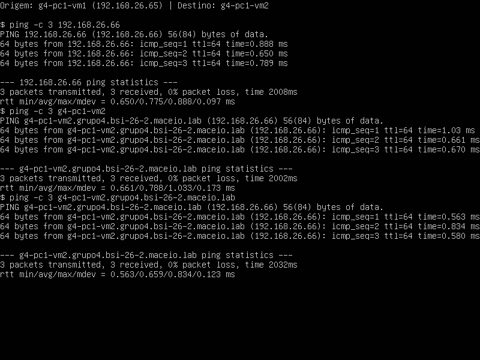

**Da `g4-pc1-vm1` para a `g4-pc2-vm1`**

```bash
ping -c 3 192.168.26.67
ping -c 3 g4-pc2-vm1
ping -c 3 g4-pc2-vm1.grupo4.bsi-26-2.maceio.lab
```


**Da `g4-pc1-vm1` para a `g4-pc2-vm2`**

```bash
ping -c 3 192.168.26.68
ping -c 3 g4-pc2-vm2
ping -c 3 g4-pc2-vm2.grupo4.bsi-26-2.maceio.lab
```


**Da `g4-pc1-vm1` para a `g4-pc3-vm1`**

```bash
ping -c 3 192.168.26.69
ping -c 3 g4-pc3-vm1
ping -c 3 g4-pc3-vm1.grupo4.bsi-26-2.maceio.lab
```


**Da `g4-pc1-vm1` para a `g4-pc3-vm2`**

```bash
ping -c 3 192.168.26.70
ping -c 3 g4-pc3-vm2
ping -c 3 g4-pc3-vm2.grupo4.bsi-26-2.maceio.lab
```


**Da `g4-pc1-vm1` para a `g4-pc4-vm1`**

```bash
ping -c 3 192.168.26.71
ping -c 3 g4-pc4-vm1
ping -c 3 g4-pc4-vm1.grupo4.bsi-26-2.maceio.lab
```


**Da `g4-pc1-vm1` para a `g4-pc4-vm2`**

```bash
ping -c 3 192.168.26.72
ping -c 3 g4-pc4-vm2
ping -c 3 g4-pc4-vm2.grupo4.bsi-26-2.maceio.lab
```


### Origem: g4-pc1-vm2 (192.168.26.66), demais destinos

**Da `g4-pc1-vm2` para a `g4-pc1-vm1`**

```bash
ping -c 3 192.168.26.65
ping -c 3 g4-pc1-vm1
ping -c 3 g4-pc1-vm1.grupo4.bsi-26-2.maceio.lab
```


**Da `g4-pc1-vm2` para a `g4-pc2-vm1`**

```bash
ping -c 3 192.168.26.67
ping -c 3 g4-pc2-vm1
ping -c 3 g4-pc2-vm1.grupo4.bsi-26-2.maceio.lab
```


**Da `g4-pc1-vm2` para a `g4-pc2-vm2`**

```bash
ping -c 3 192.168.26.68
ping -c 3 g4-pc2-vm2
ping -c 3 g4-pc2-vm2.grupo4.bsi-26-2.maceio.lab
```


**Da `g4-pc1-vm2` para a `g4-pc3-vm1`**

```bash
ping -c 3 192.168.26.69
ping -c 3 g4-pc3-vm1
ping -c 3 g4-pc3-vm1.grupo4.bsi-26-2.maceio.lab
```


**Da `g4-pc1-vm2` para a `g4-pc4-vm1`**

```bash
ping -c 3 192.168.26.71
ping -c 3 g4-pc4-vm1
ping -c 3 g4-pc4-vm1.grupo4.bsi-26-2.maceio.lab
```


**Da `g4-pc1-vm2` para a `g4-pc4-vm2`**

```bash
ping -c 3 192.168.26.72
ping -c 3 g4-pc4-vm2
ping -c 3 g4-pc4-vm2.grupo4.bsi-26-2.maceio.lab
```


### Origem: g4-pc2-vm1 (192.168.26.67)

**Da `g4-pc2-vm1` para a `g4-pc1-vm1`**

```bash
ping -c 3 192.168.26.65
ping -c 3 g4-pc1-vm1
ping -c 3 g4-pc1-vm1.grupo4.bsi-26-2.maceio.lab
```


**Da `g4-pc2-vm1` para a `g4-pc1-vm2`**

```bash
ping -c 3 192.168.26.66
ping -c 3 g4-pc1-vm2
ping -c 3 g4-pc1-vm2.grupo4.bsi-26-2.maceio.lab
```

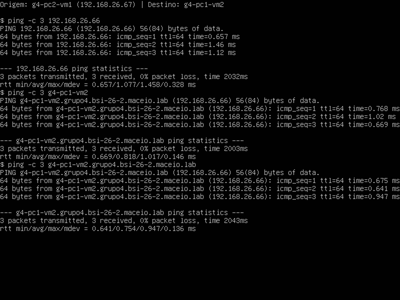

**Da `g4-pc2-vm1` para a `g4-pc2-vm2`**

```bash
ping -c 3 192.168.26.68
ping -c 3 g4-pc2-vm2
ping -c 3 g4-pc2-vm2.grupo4.bsi-26-2.maceio.lab
```


**Da `g4-pc2-vm1` para a `g4-pc3-vm1`**

```bash
ping -c 3 192.168.26.69
ping -c 3 g4-pc3-vm1
ping -c 3 g4-pc3-vm1.grupo4.bsi-26-2.maceio.lab
```


**Da `g4-pc2-vm1` para a `g4-pc3-vm2`**

```bash
ping -c 3 192.168.26.70
ping -c 3 g4-pc3-vm2
ping -c 3 g4-pc3-vm2.grupo4.bsi-26-2.maceio.lab
```


**Da `g4-pc2-vm1` para a `g4-pc4-vm1`**

```bash
ping -c 3 192.168.26.71
ping -c 3 g4-pc4-vm1
ping -c 3 g4-pc4-vm1.grupo4.bsi-26-2.maceio.lab
```


**Da `g4-pc2-vm1` para a `g4-pc4-vm2`**

```bash
ping -c 3 192.168.26.72
ping -c 3 g4-pc4-vm2
ping -c 3 g4-pc4-vm2.grupo4.bsi-26-2.maceio.lab
```


### Origem: g4-pc2-vm2 (192.168.26.68)

**Da `g4-pc2-vm2` para a `g4-pc1-vm1`**

```bash
ping -c 3 192.168.26.65
ping -c 3 g4-pc1-vm1
ping -c 3 g4-pc1-vm1.grupo4.bsi-26-2.maceio.lab
```


**Da `g4-pc2-vm2` para a `g4-pc1-vm2`**

```bash
ping -c 3 192.168.26.66
ping -c 3 g4-pc1-vm2
ping -c 3 g4-pc1-vm2.grupo4.bsi-26-2.maceio.lab
```


**Da `g4-pc2-vm2` para a `g4-pc2-vm1`**

```bash
ping -c 3 192.168.26.67
ping -c 3 g4-pc2-vm1
ping -c 3 g4-pc2-vm1.grupo4.bsi-26-2.maceio.lab
```

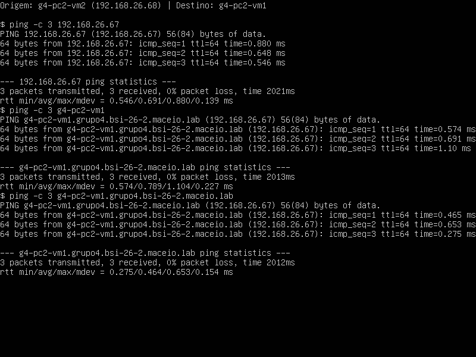

**Da `g4-pc2-vm2` para a `g4-pc3-vm1`**

```bash
ping -c 3 192.168.26.69
ping -c 3 g4-pc3-vm1
ping -c 3 g4-pc3-vm1.grupo4.bsi-26-2.maceio.lab
```


**Da `g4-pc2-vm2` para a `g4-pc3-vm2`**

```bash
ping -c 3 192.168.26.70
ping -c 3 g4-pc3-vm2
ping -c 3 g4-pc3-vm2.grupo4.bsi-26-2.maceio.lab
```


**Da `g4-pc2-vm2` para a `g4-pc4-vm1`**

```bash
ping -c 3 192.168.26.71
ping -c 3 g4-pc4-vm1
ping -c 3 g4-pc4-vm1.grupo4.bsi-26-2.maceio.lab
```

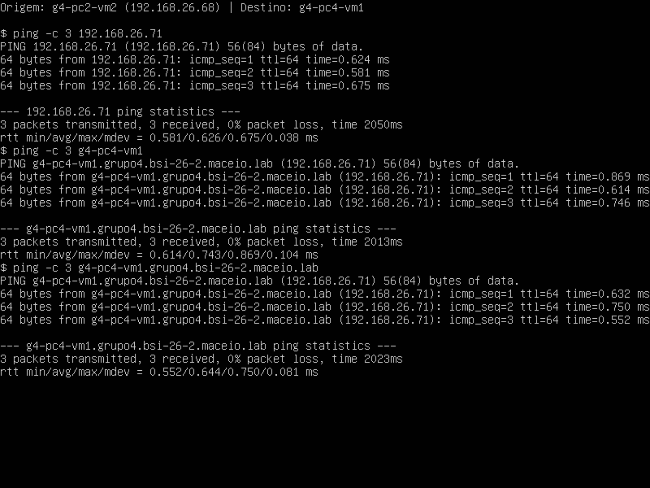

**Da `g4-pc2-vm2` para a `g4-pc4-vm2`**

```bash
ping -c 3 192.168.26.72
ping -c 3 g4-pc4-vm2
ping -c 3 g4-pc4-vm2.grupo4.bsi-26-2.maceio.lab
```

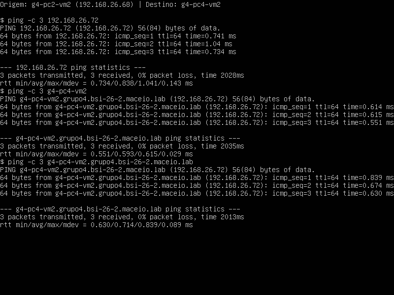

### Origem: g4-pc3-vm1 (192.168.26.69)

**Da `g4-pc3-vm1` para a `g4-pc1-vm1`**

```bash
ping -c 3 192.168.26.65
ping -c 3 g4-pc1-vm1
ping -c 3 g4-pc1-vm1.grupo4.bsi-26-2.maceio.lab
```


**Da `g4-pc3-vm1` para a `g4-pc1-vm2`**

```bash
ping -c 3 192.168.26.66
ping -c 3 g4-pc1-vm2
ping -c 3 g4-pc1-vm2.grupo4.bsi-26-2.maceio.lab
```


**Da `g4-pc3-vm1` para a `g4-pc2-vm1`**

```bash
ping -c 3 192.168.26.67
ping -c 3 g4-pc2-vm1
ping -c 3 g4-pc2-vm1.grupo4.bsi-26-2.maceio.lab
```


**Da `g4-pc3-vm1` para a `g4-pc2-vm2`**

```bash
ping -c 3 192.168.26.68
ping -c 3 g4-pc2-vm2
ping -c 3 g4-pc2-vm2.grupo4.bsi-26-2.maceio.lab
```


**Da `g4-pc3-vm1` para a `g4-pc3-vm2`**

```bash
ping -c 3 192.168.26.70
ping -c 3 g4-pc3-vm2
ping -c 3 g4-pc3-vm2.grupo4.bsi-26-2.maceio.lab
```


**Da `g4-pc3-vm1` para a `g4-pc4-vm1`**

```bash
ping -c 3 192.168.26.71
ping -c 3 g4-pc4-vm1
ping -c 3 g4-pc4-vm1.grupo4.bsi-26-2.maceio.lab
```

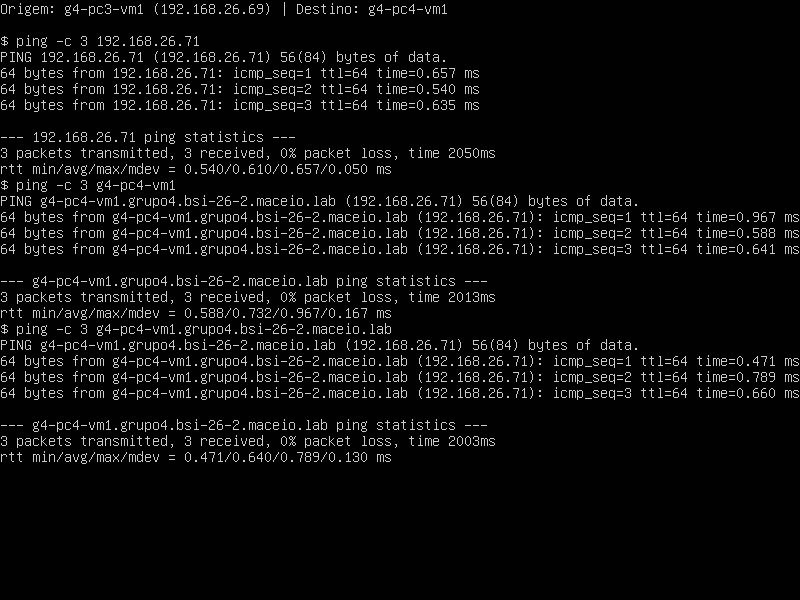

**Da `g4-pc3-vm1` para a `g4-pc4-vm2`**

```bash
ping -c 3 192.168.26.72
ping -c 3 g4-pc4-vm2
ping -c 3 g4-pc4-vm2.grupo4.bsi-26-2.maceio.lab
```


### Origem: g4-pc3-vm2 (192.168.26.70)

**Da `g4-pc3-vm2` para a `g4-pc1-vm1`**

```bash
ping -c 3 192.168.26.65
ping -c 3 g4-pc1-vm1
ping -c 3 g4-pc1-vm1.grupo4.bsi-26-2.maceio.lab
```


**Da `g4-pc3-vm2` para a `g4-pc1-vm2`**

```bash
ping -c 3 192.168.26.66
ping -c 3 g4-pc1-vm2
ping -c 3 g4-pc1-vm2.grupo4.bsi-26-2.maceio.lab
```


**Da `g4-pc3-vm2` para a `g4-pc2-vm1`**

```bash
ping -c 3 192.168.26.67
ping -c 3 g4-pc2-vm1
ping -c 3 g4-pc2-vm1.grupo4.bsi-26-2.maceio.lab
```


**Da `g4-pc3-vm2` para a `g4-pc2-vm2`**

```bash
ping -c 3 192.168.26.68
ping -c 3 g4-pc2-vm2
ping -c 3 g4-pc2-vm2.grupo4.bsi-26-2.maceio.lab
```


**Da `g4-pc3-vm2` para a `g4-pc3-vm1`**

```bash
ping -c 3 192.168.26.69
ping -c 3 g4-pc3-vm1
ping -c 3 g4-pc3-vm1.grupo4.bsi-26-2.maceio.lab
```


**Da `g4-pc3-vm2` para a `g4-pc4-vm1`**

```bash
ping -c 3 192.168.26.71
ping -c 3 g4-pc4-vm1
ping -c 3 g4-pc4-vm1.grupo4.bsi-26-2.maceio.lab
```


**Da `g4-pc3-vm2` para a `g4-pc4-vm2`**

```bash
ping -c 3 192.168.26.72
ping -c 3 g4-pc4-vm2
ping -c 3 g4-pc4-vm2.grupo4.bsi-26-2.maceio.lab
```


### Origem: g4-pc4-vm1 (192.168.26.71)

**Da `g4-pc4-vm1` para a `g4-pc1-vm1`**

```bash
ping -c 3 192.168.26.65
ping -c 3 g4-pc1-vm1
ping -c 3 g4-pc1-vm1.grupo4.bsi-26-2.maceio.lab
```


**Da `g4-pc4-vm1` para a `g4-pc1-vm2`**

```bash
ping -c 3 192.168.26.66
ping -c 3 g4-pc1-vm2
ping -c 3 g4-pc1-vm2.grupo4.bsi-26-2.maceio.lab
```


**Da `g4-pc4-vm1` para a `g4-pc2-vm1`**

```bash
ping -c 3 192.168.26.67
ping -c 3 g4-pc2-vm1
ping -c 3 g4-pc2-vm1.grupo4.bsi-26-2.maceio.lab
```


**Da `g4-pc4-vm1` para a `g4-pc2-vm2`**

```bash
ping -c 3 192.168.26.68
ping -c 3 g4-pc2-vm2
ping -c 3 g4-pc2-vm2.grupo4.bsi-26-2.maceio.lab
```


**Da `g4-pc4-vm1` para a `g4-pc3-vm1`**

```bash
ping -c 3 192.168.26.69
ping -c 3 g4-pc3-vm1
ping -c 3 g4-pc3-vm1.grupo4.bsi-26-2.maceio.lab
```


**Da `g4-pc4-vm1` para a `g4-pc3-vm2`**

```bash
ping -c 3 192.168.26.70
ping -c 3 g4-pc3-vm2
ping -c 3 g4-pc3-vm2.grupo4.bsi-26-2.maceio.lab
```


**Da `g4-pc4-vm1` para a `g4-pc4-vm2`**

```bash
ping -c 3 192.168.26.72
ping -c 3 g4-pc4-vm2
ping -c 3 g4-pc4-vm2.grupo4.bsi-26-2.maceio.lab
```


### Origem: g4-pc4-vm2 (192.168.26.72)

**Da `g4-pc4-vm2` para a `g4-pc1-vm1`**

```bash
ping -c 3 192.168.26.65
ping -c 3 g4-pc1-vm1
ping -c 3 g4-pc1-vm1.grupo4.bsi-26-2.maceio.lab
```


**Da `g4-pc4-vm2` para a `g4-pc1-vm2`**

```bash
ping -c 3 192.168.26.66
ping -c 3 g4-pc1-vm2
ping -c 3 g4-pc1-vm2.grupo4.bsi-26-2.maceio.lab
```


**Da `g4-pc4-vm2` para a `g4-pc2-vm1`**

```bash
ping -c 3 192.168.26.67
ping -c 3 g4-pc2-vm1
ping -c 3 g4-pc2-vm1.grupo4.bsi-26-2.maceio.lab
```


**Da `g4-pc4-vm2` para a `g4-pc2-vm2`**

```bash
ping -c 3 192.168.26.68
ping -c 3 g4-pc2-vm2
ping -c 3 g4-pc2-vm2.grupo4.bsi-26-2.maceio.lab
```


**Da `g4-pc4-vm2` para a `g4-pc3-vm1`**

```bash
ping -c 3 192.168.26.69
ping -c 3 g4-pc3-vm1
ping -c 3 g4-pc3-vm1.grupo4.bsi-26-2.maceio.lab
```

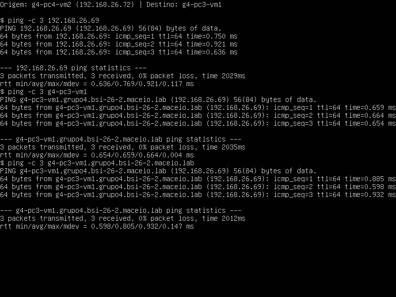

**Da `g4-pc4-vm2` para a `g4-pc3-vm2`**

```bash
ping -c 3 192.168.26.70
ping -c 3 g4-pc3-vm2
ping -c 3 g4-pc3-vm2.grupo4.bsi-26-2.maceio.lab
```


**Da `g4-pc4-vm2` para a `g4-pc4-vm1`**

```bash
ping -c 3 192.168.26.71
ping -c 3 g4-pc4-vm1
ping -c 3 g4-pc4-vm1.grupo4.bsi-26-2.maceio.lab
```


## 2. Acesso por SSH

1. Abra o console da `g4-pc1-vm1` e entre com a conta do Allysson.
2. Execute o comando abaixo para acessar a `g4-pc2-vm1` e digite a senha quando solicitada.

   ```bash
   ssh allysson.matheus@g4-pc2-vm1
   ```

3. Na sessão remota, execute os comandos abaixo. Confira o nome da VM de destino e o IP de origem na coluna `FROM`. Registre a captura e encerre com `exit`.

   ```bash
   hostname
   w
   exit
   ```

4. Repita o teste para as outras três sessões, usando a VM de origem e o comando `ssh` indicados abaixo.

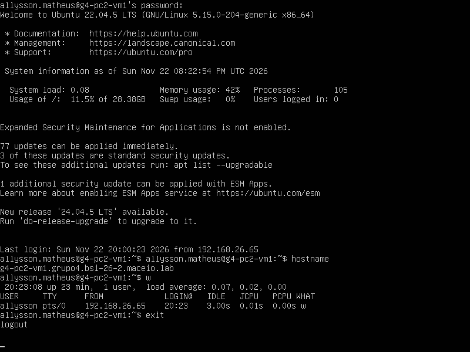

O `hostname` mostrou `g4-pc2-vm1.grupo4.bsi-26-2.maceio.lab` e `w` registrou a origem `192.168.26.65`.

### Da `g4-pc2-vm2` para a `g4-pc1-vm2`

```bash
ssh lukas.gomes@g4-pc1-vm2
```

O `hostname` mostrou `g4-pc1-vm2.grupo4.bsi-26-2.maceio.lab` e `w` registrou a origem `192.168.26.68`.

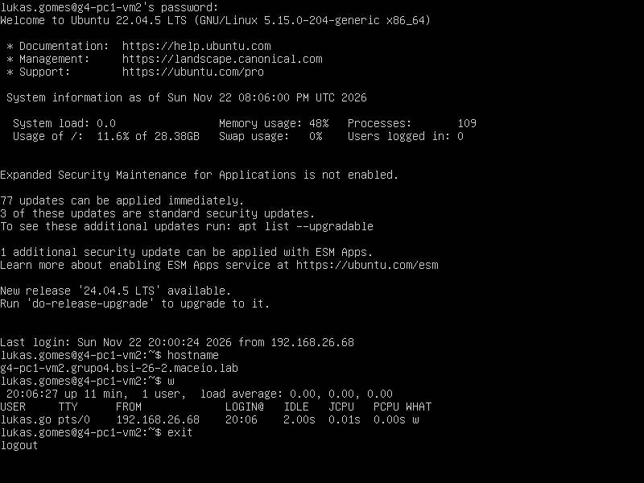

### Da `g4-pc3-vm1` para a `g4-pc4-vm1`

```bash
ssh abel.lucas@g4-pc4-vm1
```

O `hostname` mostrou `g4-pc4-vm1.grupo4.bsi-26-2.maceio.lab` e `w` registrou a origem `192.168.26.69`.

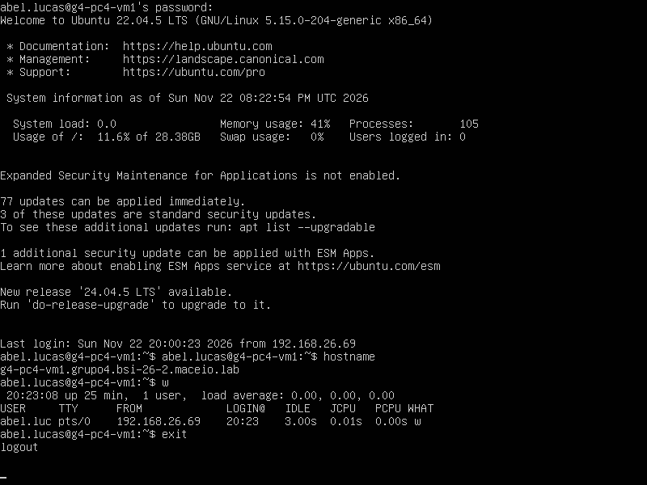

### Da `g4-pc4-vm2` para a `g4-pc3-vm2`

```bash
ssh vitor.henrique@g4-pc3-vm2
```

O `hostname` mostrou `g4-pc3-vm2.grupo4.bsi-26-2.maceio.lab` e `w` registrou a origem `192.168.26.72`.

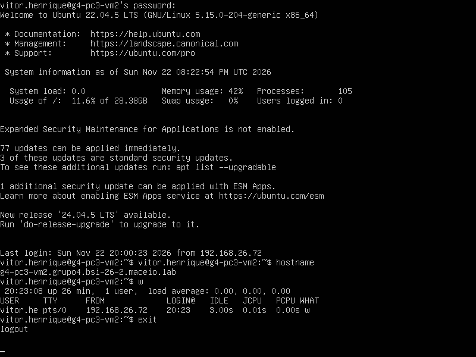

**Resultado.** As quatro contas abriram sessões SSH entre VMs do mesmo computador.

## 3. Resolução de nomes

1. No terminal da `g4-pc1-vm2`, execute o comando abaixo.

   ```bash
   getent hosts g4-pc4-vm2
   ```

2. Confira se a saída mostra o IP `192.168.26.72`, o FQDN e o apelido da VM de destino.

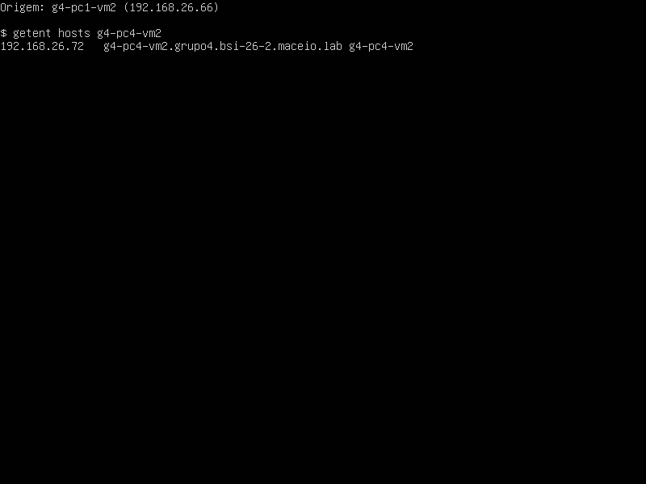

## 4. Script de validação

1. Copie o [script `validacao-pf.sh` já configurado para o Grupo 4](validacao/validacao-pf.sh) para cada VM.
2. Em cada VM, entre como `administrador`, abra a pasta onde salvou o script e execute:

   ```bash
   sudo bash validacao-pf.sh | tee validacao-$(hostname -s).txt
   ```

3. Confira se o resumo indica zero falhas e coloque os oito relatórios `validacao-<hostname>.txt` na pasta [`validacao/`](validacao/) do repositório.

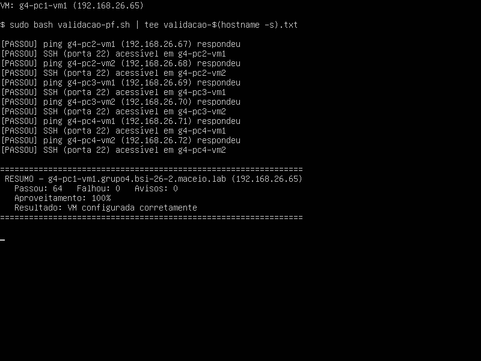

**Resultado.** Cada uma das oito VMs registrou 64 verificações aprovadas, zero falhas e zero avisos. [Relatórios das oito VMs](validacao/)

[⬅️ Voltar para hostname e hosts](05-hostname-e-hosts.md)
